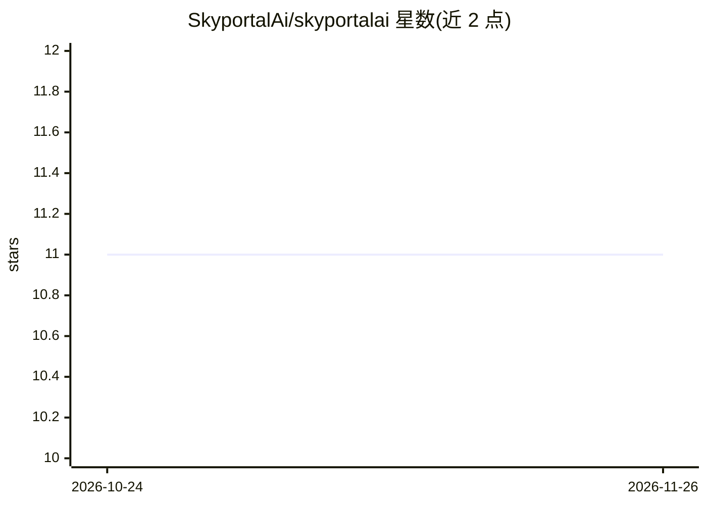

# SkyportalAi/skyportalai

⭐ 11 · Python · MIT · 推送 2026-11-16 · [GitHub](https://github.com/SkyportalAi/skyportalai) · [官网](https://skyportal.ai) · 组织维护

**AI 基础设施诊断 Agent：解释生产故障前发生了什么变化**

开源的 AI 基础设施工程师工具，通过持续观察部署、Kubernetes 事件、GPU 指标、配置变更、日志和基础设施更新，构建 AI 基础设施的时间线，跨栈关联事件并解释可能的根因。提供 Python SDK 与 CLI 两种使用方式，支持通过命令行或 Python 发起诊断、自动审批与 CI 脚本集成；CLI 还可在本机以受信任文件夹方式执行命令（类似 Claude Code 模式）。面向运维 AI 基础设施的开发者与团队。

## 筛选速览

| 维度 | 判定 | 备注 |
|---|---|---|
| AI 角色 | `ai-ecosystem` | LLM/agent 周边工具 |
| 许可风险 | `permissive` | MIT |
| 部署形态 | `library` | 以包/库形式分发 |
| 模型依赖 | — | README 未给出锁定关系 |
| 硬件要求 | — | 无带数字的原话,不猜 |
| 安装摩擦 | `low` | 无编译、无系统依赖或容器化 |
| 成熟度 | — | 结构信号不足 |

## 能力要点

- 持续观测部署/K8s 事件/GPU 指标/配置变更并构建时间线
- 关联回归事件并给出根因解释与置信度报告
- Python SDK 与 CLI 两种接入方式，支持 JSON 输出供脚本与 CI 使用
- 审批/作用域安全机制：命令须通过审批端点，命名空间白名单控制

## 适用场景

- 排查 GPU 利用率骤降或延迟翻倍前发生了什么变更
- 定位哪次部署引发了回归
- 在 CI 或脚本中自动化发起基础设施诊断
- 在终端直接对受信任的项目文件夹执行 Agent 命令

## 场景标签

`LLM 可观测性` · 领域:评测与运维

## 证据(README 行号)

> L13: Skyportal continuously builds a timeline of your AI infrastructure by observing
> L51: pip install "skyportalai[cli]"
> L96: with Skyportal(api_key="sk-...") as client:

## 星数曲线

2026-10-24 11 → 2026-11-26 11（+0）

---
*卡片 v1 · prompt 1.4 · 生成 2026-11-18 · 置信度 high · 依据 README sha `d33dc04521b2` · [字段定义](../../DATASET.md)*
