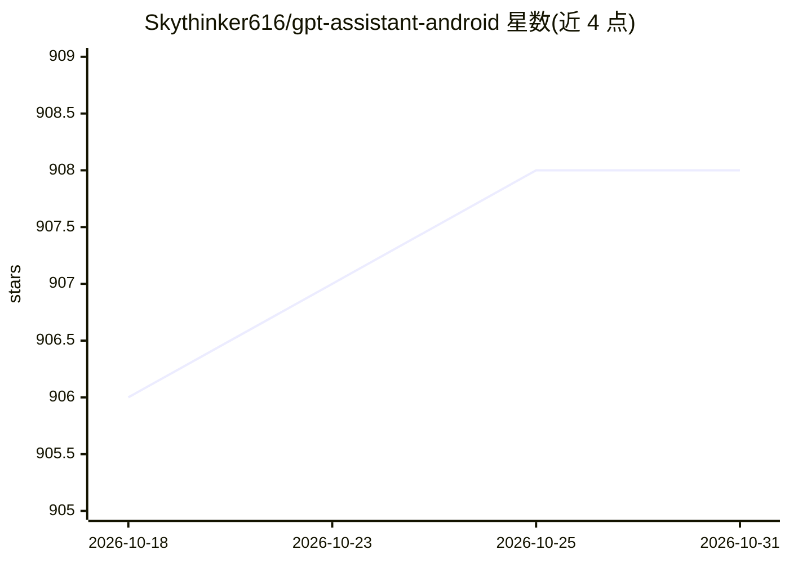

# Skythinker616/gpt-assistant-android

⭐ 908 · Java · GPL-3.0 · 推送 2026-05-05 · [GitHub](https://github.com/Skythinker616/gpt-assistant-android) · 个人维护 · 中文 README

**安卓全场景 GPT 助手：音量键唤起语音对话，支持联网与智能体操控手机**

面向安卓用户的 GPT 对话应用：通过 OpenAI API 或兼容接口提供服务，支持音量键/状态栏/划词等方式全局唤起，语音输入输出支持华为/百度/Google/Whisper 等接口。可处理图片、TXT、PDF、DOCX 等文件，经 WebView 抓取实现 GPT 联网，并提供可定制界面的智能模板。实验性智能体模式允许 AI 读取屏幕控件并执行点击、滚动、输入操作（依赖无障碍服务，需 Function 调用能力模型）。以 apk 发行版安装，智能体模式为实验性功能，不保证所有应用稳定操作。

## 筛选速览

| 维度 | 判定 | 备注 |
|---|---|---|
| AI 角色 | `ai-native` | 本体是模型或模型工具 |
| 许可风险 | `viral` | GPL-3.0 |
| 部署形态 | `None` |  |
| 模型依赖 | — | README 未给出锁定关系 |
| 硬件要求 | — | 无带数字的原话,不猜 |
| 安装摩擦 | `low` | 无编译、无系统依赖或容器化 |
| 成熟度 | `idea` | |

## 能力要点

- 音量键长按唤起，语音输入与 TTS 播报的免手操作对话
- 实验性智能体模式：AI 读取屏幕控件执行点击/滚动/输入，无需图像识别
- Function 接口实现 GPT 联网，对百度/必应/知乎/B站等站点特殊适配
- 多通道文件上传与图片/TXT/PDF/DOCX/PPTX/XLSX 解析

## 适用场景

- 在任意应用界面快速唤起 AI 问答或处理选中文本
- 让 AI 代为操控手机完成发消息、点外卖等任务
- 用语音连续对话并播报回复

## 场景标签

`语音 Agent` `AI 助手` `GUI 自动化` · 领域:效率与自动化

## 证据(README 行号)

> L5:  安卓端全场景 GPT 助手
> L77: 在主界面启用“智能体”按钮后，AI 可以读取当前屏幕中的控件，并执行点击、滚动、输入文字等操作，可以实现发消息、点外卖、查攻略等高级功能（有待你的探索喔~）

## 星数曲线

2026-10-18 906 → 2026-10-31 908（+2）

---
*卡片 v1 · prompt 1.4 · 生成 2026-10-21 · 置信度 high · 依据 README sha `37d364b5c33d` · [字段定义](../../DATASET.md)*
