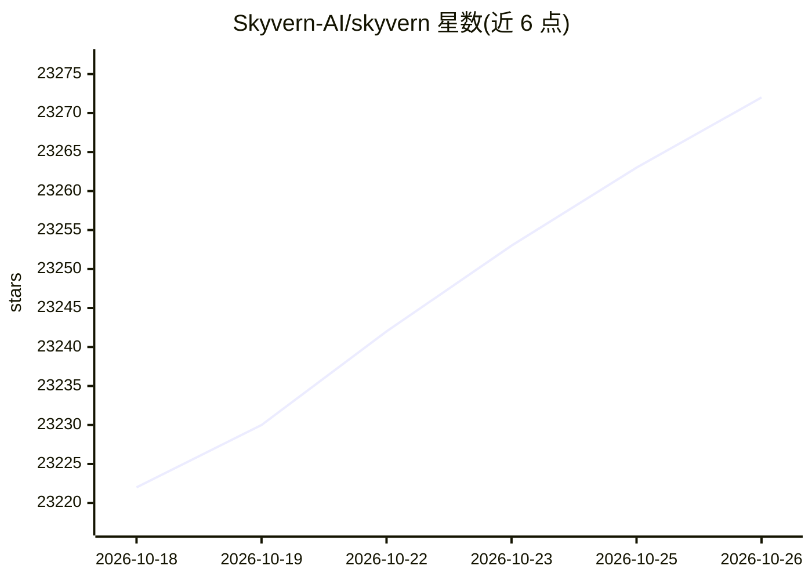

# Skyvern-AI/skyvern

⭐ 23,272 · Python · AGPL-3.0 · 推送 2026-10-25 · [GitHub](https://github.com/Skyvern-AI/skyvern) · [官网](https://www.skyvern.com) · 组织维护

**用 LLM 与视觉自动执行浏览器工作流的工具**

提供 Playwright 兼容的 SDK 与无代码工作流构建器，用视觉 LLM 理解网页并执行操作，可在未见过的网站上运行且不依赖预定义 XPath。核心命令包括 page.act/extract/validate/prompt，支持任务链（Workflows）、连接本地 Chrome、凭证管理（Skyvern/Bitwarden/1Password）。安装途径有 pip、Docker Compose，默认 SQLite 可选 Postgres，另提供托管云版本。面向技术与非技术用户自动化网页操作流程。

## 筛选速览

| 维度 | 判定 | 备注 |
|---|---|---|
| AI 角色 | `ai-native` | 本体是模型或模型工具 |
| 许可风险 | `viral` | AGPL-3.0 |
| 部署形态 | `self-host` | docker 或自建部署 |
| 模型依赖 | — | README 未给出锁定关系 |
| 硬件要求 | — | 无带数字的原话,不猜 |
| 安装摩擦 | `low` | 无编译、无系统依赖或容器化 |
| 成熟度 | — | 结构信号不足 |

## 动量与使用信号

- 维护:`active` — 距上次 push 1.1 天,年发版 63,92 位贡献者
- 涨星:近 1 天 **+7**(自 20261016 起算)
- 安装:npm 包 `@skyvern/client` 月下载 15,672
- 平台:WINDOWS / WEB · 协议:OPENAI-API / MCP / OLLAMA

## 能力要点

- Playwright 兼容 SDK，提供 act/extract/validate/prompt 四个 AI 页面命令
- 支持 Python 与 TypeScript 双 SDK（npm @skyvern/client）
- 无代码工作流构建器，任务可链式组合
- 可接管本地 Chrome（CDP 连接）并经隧道由云版控制

## 适用场景

- 自动化表单填写、登录、文件下载等 RPA 类任务
- 在多个网站上复用同一工作流抓取或下载数据
- 无代码方式搭建电商下单等网页操作流程

## 场景标签

`浏览器自动化` `工作流自动化` · 领域:效率与自动化

## 证据(README 行号)

> L7: Skyvern automates browser-based workflows using LLMs and computer vision. It provides a Playwright-compatible SDK th
> L11: Instead of only relying on code-defined XPath interactions, Skyvern relies on Vision LLMs to learn and interact wit
> L105: **Skyvern is a Playwright extension that adds AI-powered browser automation.** It gives you the full power of Play

## 星数曲线

2026-10-18 23,222 → 2026-10-26 23,272（+50）

---
*卡片 v1 · prompt 1.4 · 生成 2026-10-18 · 置信度 high · 依据 README sha `9abb6f5eb1c0` · [字段定义](../../DATASET.md)*
