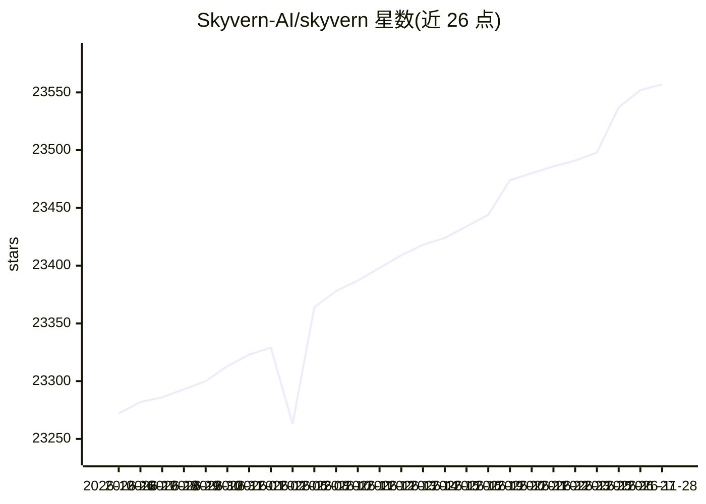

# Skyvern-AI/skyvern

⭐ 23,557 · Python · AGPL-3.0 · 推送 2026-11-27 · [GitHub](https://github.com/Skyvern-AI/skyvern) · [官网](https://www.skyvern.com) · 组织维护

**用 LLM 和视觉驱动浏览器自动化工作流的工具与 SDK**

基于 LLM 与计算机视觉自动化浏览器工作流：提供兼容 Playwright 的 SDK，在 Playwright 之上增加自然语言驱动的页面操作、数据抽取与状态校验命令；同时提供本地 API 服务器、Web UI 与无代码工作流构建器，技术与非技术用户均可使用。机制上依赖 Vision LLM 理解与操作页面，而非预定义 XPath，可在未见过的网站上运行并抵抗布局变化。支持 pip、Docker Compose 与源码部署，也可使用托管云版本（含代理与验证码处理）。

## 筛选速览

| 维度 | 判定 | 备注 |
|---|---|---|
| AI 角色 | `ai-native` | 本体是模型或模型工具 |
| 许可风险 | `viral` | AGPL-3.0 |
| 部署形态 | `self-host` | docker 或自建部署 |
| 模型依赖 | local-ok | 支持本地模型 |
| 硬件要求 | — | 无带数字的原话,不猜 |
| 安装摩擦 | `low` | 无编译、无系统依赖或容器化 |
| 成熟度 | — | 结构信号不足 |

## 动量与使用信号

- 维护:`active` — 距上次 push 1.1 天,年发版 63,92 位贡献者
- 涨星:近 1 天 **+7**(自 20261016 起算)
- 安装:npm 包 `@skyvern/client` 月下载 15,672
- 平台:WINDOWS / WEB · 协议:OPENAI-API / MCP / OLLAMA

## 能力要点

- Playwright 扩展 SDK：page.act/extract/validate/prompt 四个核心 AI 命令
- 标准 Playwright 动作支持 prompt 参数实现 AI 元素定位
- 任务与工作流两级结构，可串联多任务形成完整流程
- 支持接管本地 Chrome（保留 cookies、登录态与扩展）

## 适用场景

- 自动填写表单、登录网站、下载文件等重复性操作
- 批量在多个网站上执行同一工作流（如批量下载发票）
- 从网页中按 JSON schema 抽取结构化数据
- 替代页面布局变更后频繁失效的选择器脚本

## 场景标签

`浏览器自动化` · 领域:效率与自动化

## 证据(README 行号)

> L7: Skyvern automates browser-based workflows using LLMs and computer vision. It provides a Playwright-compatible SDK th
> L107: **Skyvern is a Playwright extension that adds AI-powered browser automation.** It gives you the full power of Play
> L123: |`page.act(prompt)`|Perform actions using natural language (e.g., "Click the login button")|

## 星数曲线

2026-10-26 23,272 → 2026-11-28 23,557（+285）

---
*卡片 v1 · prompt 1.4 · 生成 2026-11-22 · 置信度 high · 依据 README sha `eee82f4cfab4` · [字段定义](../../DATASET.md)*
