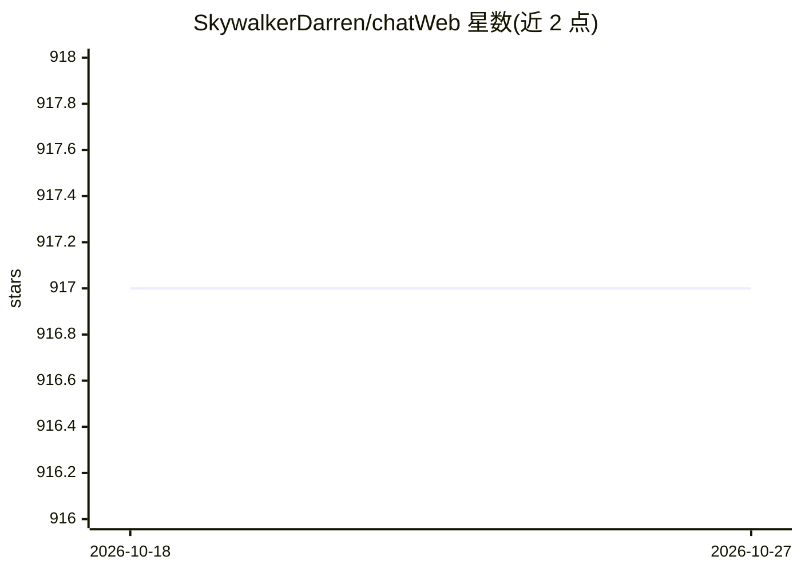

# SkywalkerDarren/chatWeb

⭐ 917 · Python · MIT · 推送 2026-05-25 · [GitHub](https://github.com/SkywalkerDarren/chatWeb) · 个人维护 · 中文 README

**网页/PDF/DOCX/TXT 内容问答与摘要工具**

基于 GPT-3.5 chat API 与 embedding API 的文档问答应用：爬取网页或读取 PDF/DOCX/TXT 提取正文，对每段生成向量并计算与全文向量的相似度以生成摘要，向量-文本映射存入向量数据库（可用 faiss 内存存储或 PostgreSQL+pgvector）；问答时从用户输入生成关键词、向量近邻检索后由 GPT3.5 生成回答。支持 console/api/webui 三种启动模式、流式输出、温度与 OpenAI 代理设置，提供手动安装与 Docker 两种部署方式，需自备 OpenAI API key。

## 筛选速览

| 维度 | 判定 | 备注 |
|---|---|---|
| AI 角色 | `ai-native` | 本体是模型或模型工具 |
| 许可风险 | `permissive` | MIT |
| 部署形态 | `self-host` | docker 或自建部署 |
| 模型依赖 | — | README 未给出锁定关系 |
| 硬件要求 | — | 无带数字的原话,不猜 |
| 安装摩擦 | `low` | 无编译、无系统依赖或容器化 |
| 成熟度 | — | 结构信号不足 |

## 能力要点

- 网页/PDF/DOCX/TXT 内容提取与向量摘要生成
- 基于关键词向量近邻检索的回答生成流程
- console/api/webui 三种模式，支持流式输出与代理
- faiss 内存存储或 PostgreSQL+pgvector 可选

## 适用场景

- 给长文档或网页做要点摘要
- 基于文档内容提问并获得引用相关段落的回答
- 通过 API 或 webui 对外提供文档问答服务

## 场景标签

`文档问答` · 领域:知识与检索

## 证据(README 行号)

> L8: ChatWeb can crawl any webpage or extract text from PDF, DOCX, TXT files, and generate an embedded summary.
> L10: It is implemented using the chatAPI and embeddingAPI based on gpt3.5, as well as a vector database.
> L23: Use GPT3.5's chat API to design a prompt that answers the user's question based on the most similar texts in the li

## 星数曲线

2026-10-18 917 → 2026-10-27 917（+0）

---
*卡片 v1 · prompt 1.4 · 生成 2026-10-21 · 置信度 mid · 依据 README sha `675f3c5acbeb` · [字段定义](../../DATASET.md)*
