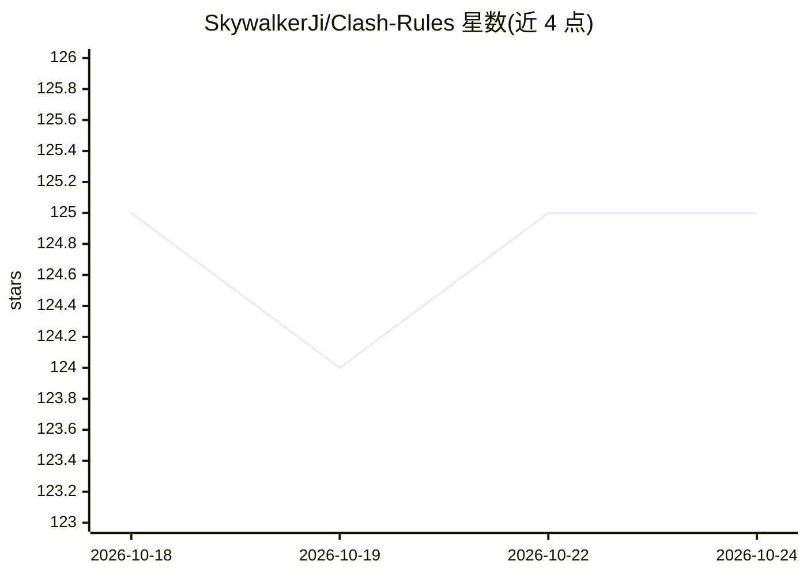

# SkywalkerJi/Clash-Rules

⭐ 125 · GPL-3.0 · 推送 2026-09-10 · [GitHub](https://github.com/SkywalkerJi/Clash-Rules) · 个人维护 · 中文 README

**自用 Clash 策略规则集合：覆盖游戏、AI 服务与加密货币分流**

维护者自用的 Clash 规则文件合集，以表格形式列出各规则文件覆盖的服务，包括 DMM、艦これ、ウマ娘等游戏平台，以及 OpenAI、Anthropic、Gemini、xAI、Cursor、AugmentCode、Trae、Windsurf、AppleIntelligence 等 AI 服务的分流规则，另有 Binance、Bybit、Polymarket 等加密货币规则。使用方式为 Clash Rule Provider 订阅或参照 yaml 样例配置，附有 KanColle 修改教程与社区自动订阅转换入口。维护者声明部分规则（如 ACGPOWER、AI 类）仍在测试或不够完善。

## 筛选速览

| 维度 | 判定 | 备注 |
|---|---|---|
| AI 角色 | `ai-ecosystem` | LLM/agent 周边工具 |
| 许可风险 | `viral` | GPL-3.0 |
| 部署形态 | `None` |  |
| 模型依赖 | — | README 未给出锁定关系 |
| 硬件要求 | — | 无带数字的原话,不猜 |
| 安装摩擦 | `low` | 无编译、无系统依赖或容器化 |
| 成熟度 | `idea` | |

## 能力要点

- 以表格列出 20+ 个规则文件及其覆盖服务
- 含 OpenAI/Anthropic/Gemini/xAI 等主流 AI 服务分流规则
- 提供 Clash yaml rule-providers 配置样例

## 适用场景

- Clash 用户订阅现成规则实现对游戏与 AI 服务的分流
- 艦これ等日服游戏玩家按需选择专用策略组
- 配置加密货币交易所与链上服务的代理规则

## 场景标签

 · 领域:网络代理/规则配置

## 证据(README 行号)

> L19: |AI|各家 AI 服务（还在测试中，不完善），Cursor 和 openAI 也移动到这里|
> L24: |Cursor|Cursor 服务|

## 星数曲线

2026-10-18 125 → 2026-10-24 125（+0）

---
*卡片 v1 · prompt 1.4 · 生成 2026-10-23 · 置信度 mid · 依据 README sha `fee32c521b6b` · [字段定义](../../DATASET.md)*
