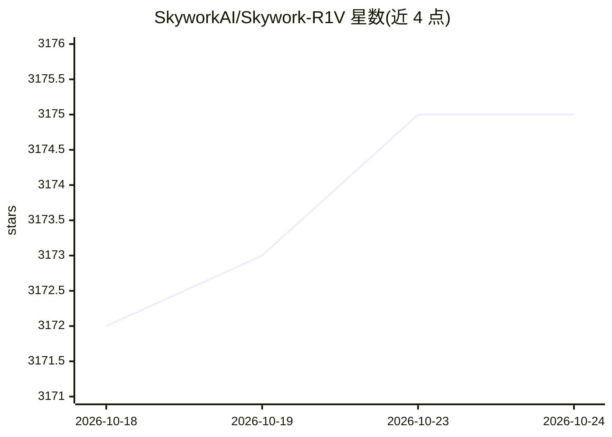

# SkyworkAI/Skywork-R1V

⭐ 3,175 · Python · MIT · 推送 2026-07-29 · [GitHub](https://github.com/SkyworkAI/Skywork-R1V) · [官网](https://arxiv.org/abs/2504.05599) · 组织维护

**开源多模态推理模型系列（38B），视觉-语言思维链推理**

Skywork AI 开发的多模态推理模型系列仓库，提供模型权重与推理代码，覆盖 R1V/R1V2/R1V3 三代 38B 模型及 AWQ 量化版（支持 30GB 以上单卡推理）。模型经强化学习后训练（RL finetuning），在 MMMU、MathVista、MathVerse 等多模态推理基准上有评测结果，评测复现代码位于 eval 目录。本地运行提供 Transformers 与 vLLM 两种推理脚本；R1V3 发布于 2025 年 7 月 9 日，附 arXiv 技术报告。代码仓库采用 MIT 许可证。

## 筛选速览

| 维度 | 判定 | 备注 |
|---|---|---|
| AI 角色 | `ai-native` | 本体是模型或模型工具 |
| 许可风险 | `permissive` | MIT |
| 部署形态 | `None` |  |
| 模型依赖 | local-ok | 支持本地模型 |
| 硬件要求 | — | 无带数字的原话,不猜 |
| 安装摩擦 | `low` | 无编译、无系统依赖或容器化 |
| 成熟度 | — | 结构信号不足 |

## 能力要点

- 三份技术报告（R1V/R1V2/R1V3）发布于 arXiv
- AWQ 量化版支持 30GB 以上显存单卡推理
- 提供 Transformers 与 vLLM 两种本地推理脚本
- eval 目录提供基准评测复现代码

## 适用场景

- 本地部署多模态推理模型进行图文问答
- 复现论文中的多模态基准评测结果
- 在数学、逻辑、物理等视觉推理任务上做推理实验

## 场景标签

`多模态` · 领域:感知与多模态

## 证据(README 行号)

> L6: Welcome to the Skywork-R1V3 repository! Here, you'll find the model weights and inference code for our state-of-the-
> L23: Skywork-R1V3-38B demonstrates state-of-the-art performance on various multimodal reasoning tasks. We provide the co

## 星数曲线

2026-10-18 3,172 → 2026-10-24 3,175（+3）

---
*卡片 v1 · prompt 1.4 · 生成 2026-10-20 · 置信度 high · 依据 README sha `8a574e2b08e5` · [字段定义](../../DATASET.md)*
