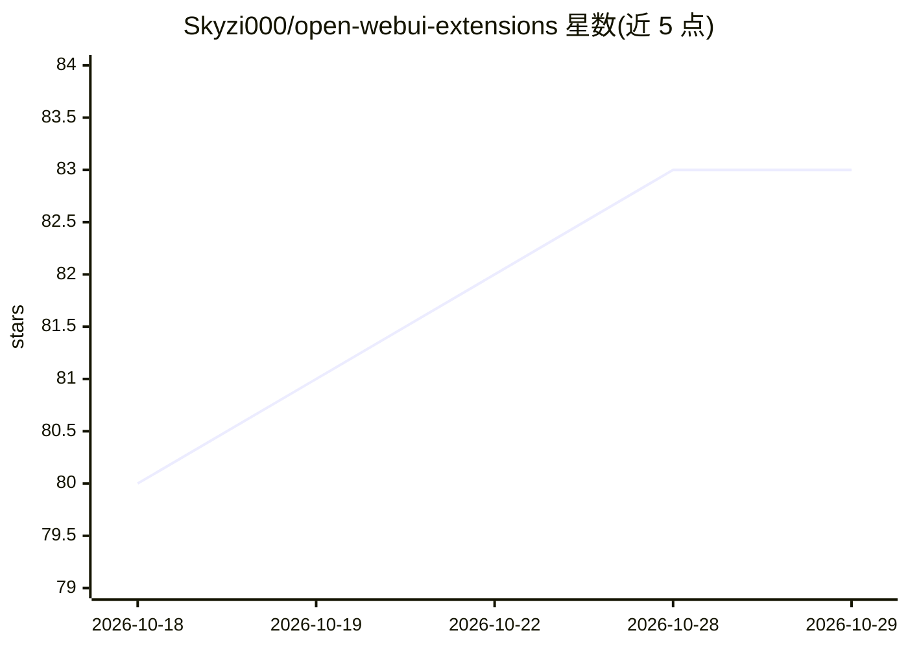

# Skyzi000/open-webui-extensions

⭐ 83 · Python · MIT · 推送 2026-10-19 · [GitHub](https://github.com/Skyzi000/open-webui-extensions) · 个人维护 · 中文 README

**为 Open WebUI 提供的子代理、并行工具等工具与过滤器集合**

面向 Open WebUI 平台的工具（Tools）与过滤器（Filters）扩展集合：核心的 Sub Agent Tool 将工具密集型任务委托给隔离上下文中的子代理执行，自 v0.6 起支持历史压缩与大结果预览（可通过 agent_ref_exec 回读）以维持长任务运行；另有并行工具调用、多模型多数表决投票、知识图谱记忆扩展（基于 Graphiti 的子模块）及日期时间/用户信息注入过滤器等。通过 git clone 源码（含 submodule）方式安装。

## 筛选速览

| 维度 | 判定 | 备注 |
|---|---|---|
| AI 角色 | `ai-ecosystem` | LLM/agent 周边工具 |
| 许可风险 | `permissive` | MIT |
| 部署形态 | `None` |  |
| 模型依赖 | — | README 未给出锁定关系 |
| 硬件要求 | — | 无带数字的原话,不猜 |
| 安装摩擦 | `low` | 无编译、无系统依赖或容器化 |
| 成熟度 | — | 结构信号不足 |

## 能力要点

- Sub Agent Tool 将工具密集任务委托给隔离上下文的子代理，openwebui.com 下载量 20,000+
- v0.6 起支持自动历史压缩与大型工具结果预览（阈值均可在 Valves 配置）
- 含并行工具调用、多模型多数表决、Pandoc 文件生成等 6 个工具
- 基于 Graphiti 的知识图谱记忆扩展（独立仓库 submodule 形式引用）

## 适用场景

- 在 Open WebUI 中让子代理处理工具密集任务，保持主对话上下文干净
- 并行执行多个独立工具调用以加快执行
- 为对话注入当前时间/用户信息而不破坏 prompt 缓存

## 场景标签

`多智能体` `Agent 记忆` · 领域:Agent 开发

## 证据(README 行号)

> L5: A collection of tools and filters for Open WebUI.
> L41: |**Sub Agent**|Delegate tasks to autonomous sub-agents to keep context consumption low|

## 星数曲线

2026-10-18 80 → 2026-10-29 83（+3）

---
*卡片 v1 · prompt 1.4 · 生成 2026-10-24 · 置信度 high · 依据 README sha `c7a25cfbe309` · [字段定义](../../DATASET.md)*
