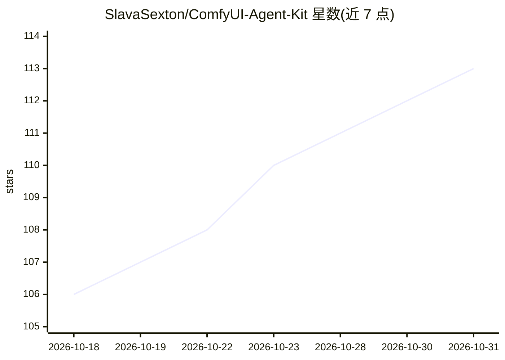

# SlavaSexton/ComfyUI-Agent-Kit

⭐ 113 · Python · Apache-2.0 · 推送 2026-09-03 · [GitHub](https://github.com/SlavaSexton/ComfyUI-Agent-Kit) · [官网](https://aivfxnews.com/) · 组织维护

**让 AI 编码代理驱动本地 ComfyUI 的技能与 MCP 工具包**

面向 Claude Code、Codex、Gemini CLI、Qwen Code 四类 AI 编码代理的本地 ComfyUI 驱动套件：一个共享核心（知识库 + 约 90 工具的 comfyui-mcp MCP 驱动）加每代理一个薄适配器，克隆后运行安装器即可接线。功能包括生成图像/视频/音频、构建并校验工作流（581 官方模板 + 94 子图蓝图）、按 VRAM/RAM/磁盘做硬件感知的模型选型、自动启动 ComfyUI、把生成图写入画布并保存。附带 75 条模型提示词配方（覆盖 68 个模型）、ComfyUI-OCIO 九节点调色工具及 seedance/krea/minimax-h3 独立技能。Apache-2.0，本地运行，无云端账户。

## 筛选速览

| 维度 | 判定 | 备注 |
|---|---|---|
| AI 角色 | `ai-ecosystem` | LLM/agent 周边工具 |
| 许可风险 | `permissive` | Apache-2.0 |
| 部署形态 | `None` |  |
| 模型依赖 | locked-api |  |
| 硬件要求 | — | 无带数字的原话,不猜 |
| 安装摩擦 | `low` | 无编译、无系统依赖或容器化 |
| 成熟度 | — | 结构信号不足 |

## 能力要点

- 约 90 工具的 MCP 驱动：生成、构建/校验图、队列、下载模型、读日志
- 75 条模型提示词配方覆盖 68 个命名模型（图像/视频/音频/3D）
- 硬件感知模型选型：检测 VRAM/RAM/磁盘并推荐适配变体
- 581 官方工作流模板 + 94 子图蓝图，含模型 shootout 对比流程

## 适用场景

- 用 Claude Code 等编码代理直接在本地 ComfyUI 上生成图像和视频
- 让代理按自己 GPU 显存挑选合适的模型变体再下载
- 复用官方模板库组装并校验新工作流
- 在 ComfyUI 内做 ACES 调色与 ProRes 输出的 VFX 流程

## 场景标签

`图像生成` `视频生成` · 领域:内容生成

## 证据(README 行号)

> L11: Make Claude Code, Codex, Gemini CLI, or Qwen Code drive **ComfyUI** at full power on your own machine - generate
> L21: This is the portable, machine-independent, **multi-agent** version of a working ComfyUI setup. One shared core
> L40: - **~90-tool MCP driver.** The agent operates ComfyUI directly: generate, build / edit / validate graphs, queue,

## 星数曲线

2026-10-18 106 → 2026-10-31 113（+7）

---
*卡片 v1 · prompt 1.4 · 生成 2026-10-23 · 置信度 high · 依据 README sha `10ce9fb830d5` · [字段定义](../../DATASET.md)*
