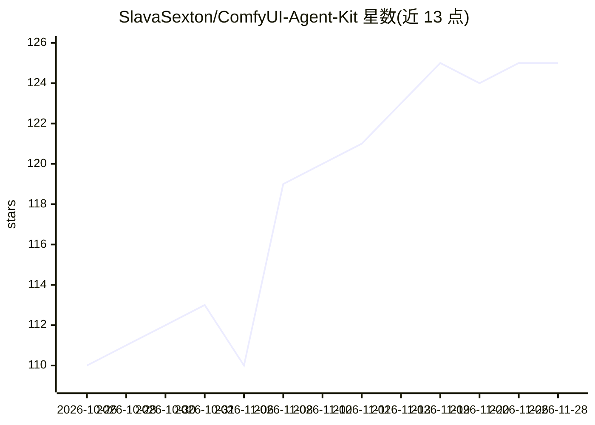

# SlavaSexton/ComfyUI-Agent-Kit

⭐ 125 · Python · Apache-2.0 · 推送 2026-11-02 · [GitHub](https://github.com/SlavaSexton/ComfyUI-Agent-Kit) · [官网](https://chronicleofbrothers.com/) · 个人维护

**让 AI 编码代理驱动本地 ComfyUI 生成图像/视频/音频的技能包**

一个装进 Claude Code、Codex、Gemini CLI、Qwen Code 技能目录的 ComfyUI 操作套件，由共享核心（知识文件 + MCP 驱动器）加每代理适配层组成。约 90 个 MCP 工具让代理直接生成、搭建/校验工作流图、排队、下载模型、管理显存与诊断；附带 75 条模型提示词配方（68 个命名模型）、581 个官方模板索引、94 个 Subgraph Blueprints，并按显存/内存/磁盘推荐模型变体（fp8/offload/量化），装不下会拒绝下载。v2 增加 ComfyUI-OCIO 九个 OpenColorIO 节点。本地优先，无托管服务，Apache-2.0。

## 筛选速览

| 维度 | 判定 | 备注 |
|---|---|---|
| AI 角色 | `ai-ecosystem` | LLM/agent 周边工具 |
| 许可风险 | `permissive` | Apache-2.0 |
| 部署形态 | `None` |  |
| 模型依赖 | locked-api |  |
| 硬件要求 | — | 无带数字的原话,不猜 |
| 安装摩擦 | `low` | 无编译、无系统依赖或容器化 |
| 成熟度 | — | 结构信号不足 |

## 能力要点

- 约 90 工具的 MCP 驱动器：代理直接生成、建图、排队、下载模型、管理显存
- 硬件感知选型：检测 VRAM/RAM/磁盘后推荐变体并拒绝装不下的下载
- 75 条按模型拆分的提示词配方 + 581 模板库与按哈希获取共享工作流
- 四个代理共用一个核心，一个安装器自动检测并接线

## 适用场景

- 让 Claude Code 在本机端到端生成图像和视频
- 把 VFX 调色（ACES/OCIO）流水线交给代理操作
- 按本机显存自动挑选能跑的模型变体
- 把整套 ComfyUI + 代理配置一条命令交给他人

## 场景标签

`编码 Agent` `图像生成` `视频生成` · 领域:编码与开发

## 证据(README 行号)

> L5: **Local-first ComfyUI for every AI coding agent (Claude Code, Codex, Gemini CLI, Qwen Code).**
> L21: This is the portable, machine-independent, **multi-agent** version of a working ComfyUI setup. One shared core
> L89: |2|**MCP driver** ~90 structured tools so the agent operates ComfyUI directly|`comfyui-mcp` (npm) + per-agent MCP r

## 星数曲线

2026-10-26 110 → 2026-11-28 125（+15）

---
*卡片 v1 · prompt 1.4 · 生成 2026-11-28 · 置信度 high · 依据 README sha `956596285914` · [字段定义](../../DATASET.md)*
