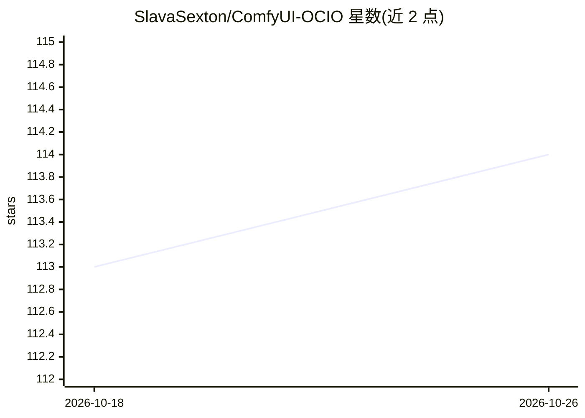

# SlavaSexton/ComfyUI-OCIO

⭐ 114 · Python · Apache-2.0 · 推送 2026-08-26 · [GitHub](https://github.com/SlavaSexton/ComfyUI-OCIO) · [官网](https://aivfxnews.com/) · 组织维护

**ComfyUI 的 Nuke 风格 OpenColorIO 色彩管理节点包**

为 ComfyUI 提供的十一个色彩管理节点与一个合成工具（OCIO Clip Repair），基于 OpenColorIO 与内置 ACES 配置：色彩空间转换、ASC CDL 调色、Display/LUT/Look 变换、带实时曝光的浮点节点内查看器，以及读取 EXR/ProRes/序列/视频并按色彩管理写回的 Read/Write 节点。VAE 解码以 float32 无钳制进行，输出覆盖 32 位 EXR、ProRes 4444、DPX、Rec.2100 PQ/HLG 等。视频功能需自行安装完整版 ffmpeg，EXR 需设置 OPENCV_IO_ENABLE_OPENEXR=1。面向在 ComfyUI 中做影视级调色与 HDR 交付的用户。

## 筛选速览

| 维度 | 判定 | 备注 |
|---|---|---|
| AI 角色 | `ai-ecosystem` | LLM/agent 周边工具 |
| 许可风险 | `permissive` | Apache-2.0 |
| 部署形态 | `self-host` | docker 或自建部署 |
| 模型依赖 | — | README 未给出锁定关系 |
| 硬件要求 | — | 无带数字的原话,不猜 |
| 安装摩擦 | `low` | 无编译、无系统依赖或容器化 |
| 成熟度 | — | 结构信号不足 |

## 能力要点

- 十一个基于 OpenColorIO/ACES 的色彩管理节点，仿 Nuke OCIO 节点集
- OCIO VAE Decode 以 float32 解码且全程无钳制（含负值）
- 支持 ComfyUI 原生 VIDEO 连线，可输出 EXR/ProRes/DNxHR/FFV1/h264/hevc（MOV/MXF/MP4/MKV）
- OCIO Clip Repair 将 SDR 转 HDR 重建仅合成进被裁切的高光/阴影区域

## 适用场景

- 在 ComfyUI 工作流里以 ACES 流程调色并输出色彩管理的成片
- 把模型生成的 HDR/浮点画面无损写成 32 位 EXR 或 FFV1 存档文件
- 读取磁盘上的序列帧或视频、转换色彩空间后再写回交付格式
- 走 LTX-2.5 的 ACEScct HDR 通道

## 场景标签

`图像视频处理` · 领域:感知与多模态

## 证据(README 行号)

> L57: Eleven color-management nodes for ComfyUI, modelled on **The Foundry Nuke's OCIO node set** and backed by
> L63: Every node is a standard ComfyUI node, so it interoperates with the whole ecosystem on plain `IMAGE` / `MASK` /
> L66: ComfyUI's native video graph as color and light stages: `Load Video -> OCIO color node -> Video Combine / Save

## 星数曲线

2026-10-18 113 → 2026-10-26 114（+1）

---
*卡片 v1 · prompt 1.4 · 生成 2026-10-23 · 置信度 mid · 依据 README sha `2716e5f3564f` · [字段定义](../../DATASET.md)*
