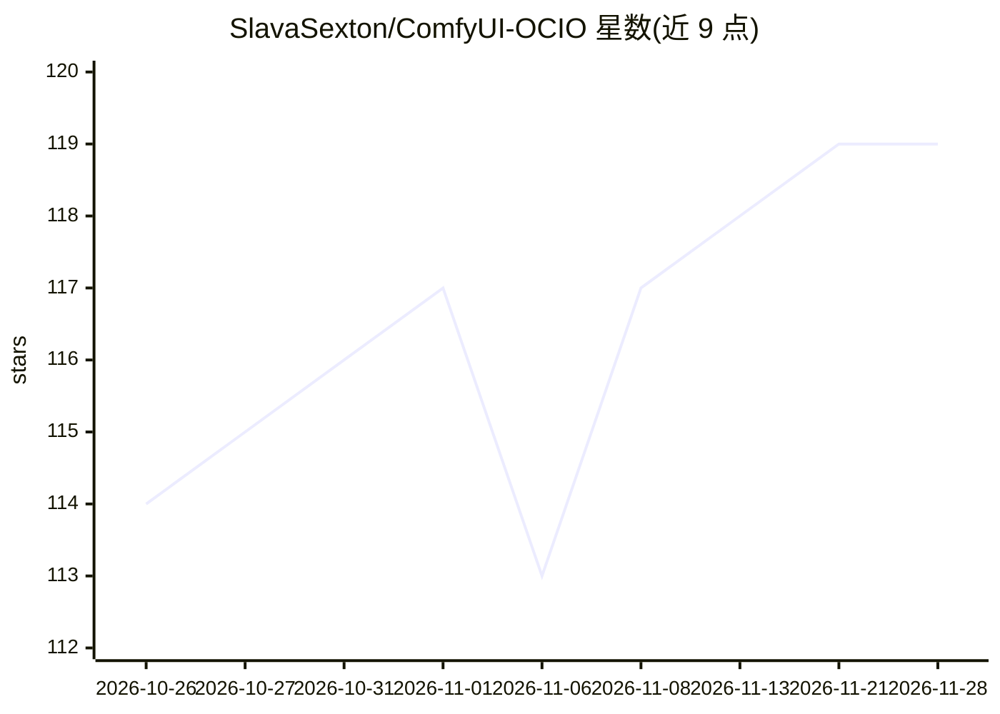

# SlavaSexton/ComfyUI-OCIO

⭐ 119 · Python · Apache-2.0 · 推送 2026-11-02 · [GitHub](https://github.com/SlavaSexton/ComfyUI-OCIO) · [官网](https://chronicleofbrothers.com/) · 个人维护

**为 ComfyUI 提供 Nuke 式 OCIO 色彩管理节点**

一组面向 ComfyUI 的 OpenColorIO 色彩管理自定义节点，仿照 The Foundry Nuke 的 OCIO 节点集实现，内置 ACES 配置。提供 11 个色彩节点与 1 个 Clip Repair 合成工具，支持 EXR/DPX/TIFF/PNG/JPEG 静帧与序列读写，以及 ProRes/DNxHR/FFV1/h264/hevc 视频输出；解码路径以 float32 不钳位方式运行，节点带实时曝光的浮点查看器。节点走 ComfyUI 原生 VIDEO 管线，与标准 IMAGE/MASK/FLOAT 类型互操作。安装需 ComfyUI 环境，视频功能依赖系统 PATH 上的完整版 ffmpeg。

## 筛选速览

| 维度 | 判定 | 备注 |
|---|---|---|
| AI 角色 | `ai-enhanced` | 去掉 AI 部分产品仍成立 |
| 许可风险 | `permissive` | Apache-2.0 |
| 部署形态 | `self-host` | docker 或自建部署 |
| 模型依赖 | — | README 未给出锁定关系 |
| 硬件要求 | — | 无带数字的原话,不猜 |
| 安装摩擦 | `low` | 无编译、无系统依赖或容器化 |
| 成熟度 | — | 结构信号不足 |

## 能力要点

- 11 个 OCIO 色彩节点：色彩空间转换、ASC CDL 调色、显示变换与 LUT
- float32 无钳位解码，保留负值与场景线性范围
- 写入 EXR/DPX/TIFF/PNG/JPEG 与 ProRes/DNxHR/FFV1/h264/hevc（MOV/MXF/MP4/MKV）
- 节点内浮点查看器支持实时曝光预览

## 适用场景

- 在 ComfyUI 工作流中以 ACES 色彩空间调色
- 将生成的图像序列色彩受控地输出为 ProRes/EXR 交付文件
- SDR 转 HDR 重建结果仅合成到高光裁切区域

## 场景标签

`图像生成` `图像视频处理` · 领域:内容生成

## 证据(README 行号)

> L57: Eleven color-management nodes for ComfyUI, modelled on **The Foundry Nuke's OCIO node set** and backed by
> L63: Every node is a standard ComfyUI node, so it interoperates with the whole ecosystem on plain `IMAGE` / `MASK` /
> L65: now also carry a native ComfyUI **VIDEO** input and output beside the IMAGE one, so they drop straight into

## 星数曲线

2026-10-26 114 → 2026-11-28 119（+5）

---
*卡片 v1 · prompt 1.4 · 生成 2026-11-28 · 置信度 mid · 依据 README sha `e6cea81f9e85` · [字段定义](../../DATASET.md)*
