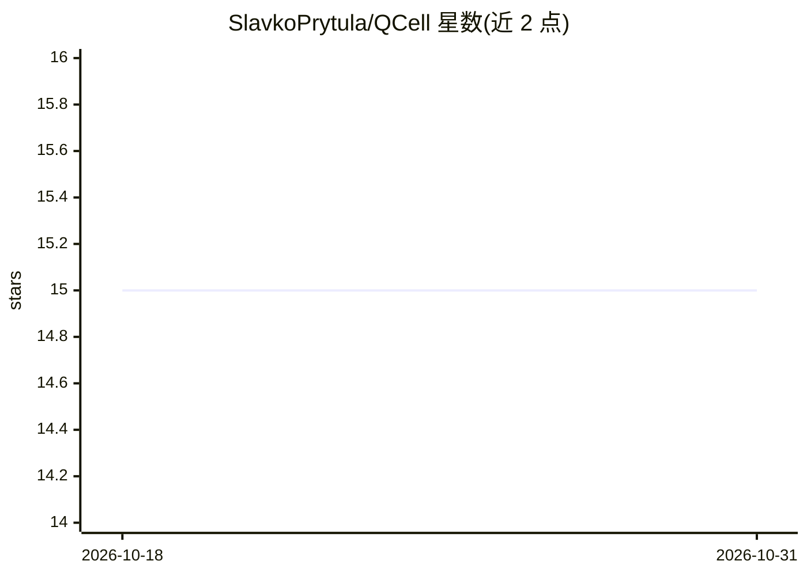

# SlavkoPrytula/QCell

⭐ 15 · JavaScript · 推送 2026-09-01 · [GitHub](https://github.com/SlavkoPrytula/QCell) · [官网](https://slavkoprytula.github.io/QCell/) · 组织维护

**重叠细胞实例分割的官方研究代码（BMVC 2026 论文）**

QCell 是 BMVC 2026 论文的重叠细胞实例分割官方代码，基于 MaskDINO 式查询分割管线，新增实例重组（将每个查询分解为 amodal/visible/occluded 子表示再重组）与对比查询对齐两个模块。支持 ISBI 2014、Revvity-25 及随论文发布的新数据集 Organoids 三个显微成像基准的训练与评估。环境为 Python 3.10、PyTorch 2.11、CUDA 12.8 与 Detectron2 0.6；完整安装说明与预训练权重将随源码发布时给出，数据集 Organoids 需申请获取。

## 筛选速览

| 维度 | 判定 | 备注 |
|---|---|---|
| AI 角色 | `ai-native` | 本体是模型或模型工具 |
| 许可风险 | `none` | — |
| 部署形态 | `None` |  |
| 模型依赖 | — | README 未给出锁定关系 |
| 硬件要求 | — | 无带数字的原话,不猜 |
| 安装摩擦 | `medium` | 含编译或系统依赖之一 |
| 成熟度 | — | 结构信号不足 |

## 能力要点

- 实例重组：查询分解为 amodal/visible/occluded 子表示并重组
- 对比查询对齐：以匹配实例查询为锚、DN 查询为正负样本
- 随论文引入 Organoids 新基准（2,586 张明场显微图像）
- 提供三个基准的示例训练配置与训练/评估命令

## 适用场景

- 在显微图像数据集上训练重叠细胞实例分割模型
- 复现论文在 ISBI 2014 / Revvity-25 / Organoids 上的结果
- 为细胞分割研究引入 amodal（遮挡感知）标注流程

## 场景标签

`目标检测` · 领域:感知与多模态

## 证据(README 行号)

> L27:  Overview of QCell. QCell builds on a MaskDINO-style query-based segmentation pipeline, where multi-scale image fea
> L41: 1. **Instance recombination** decomposes each object query into amodal, visible, and occluded sub-representations, 
> L44: QCell improves overlapping-cell separation across multiple microscopy benchmarks, including ISBI 2014, Revvity-25, 

## 星数曲线

2026-10-18 15 → 2026-10-31 15（+0）

---
*卡片 v1 · prompt 1.4 · 生成 2026-10-30 · 置信度 high · 依据 README sha `e04e56f32588` · [字段定义](../../DATASET.md)*
