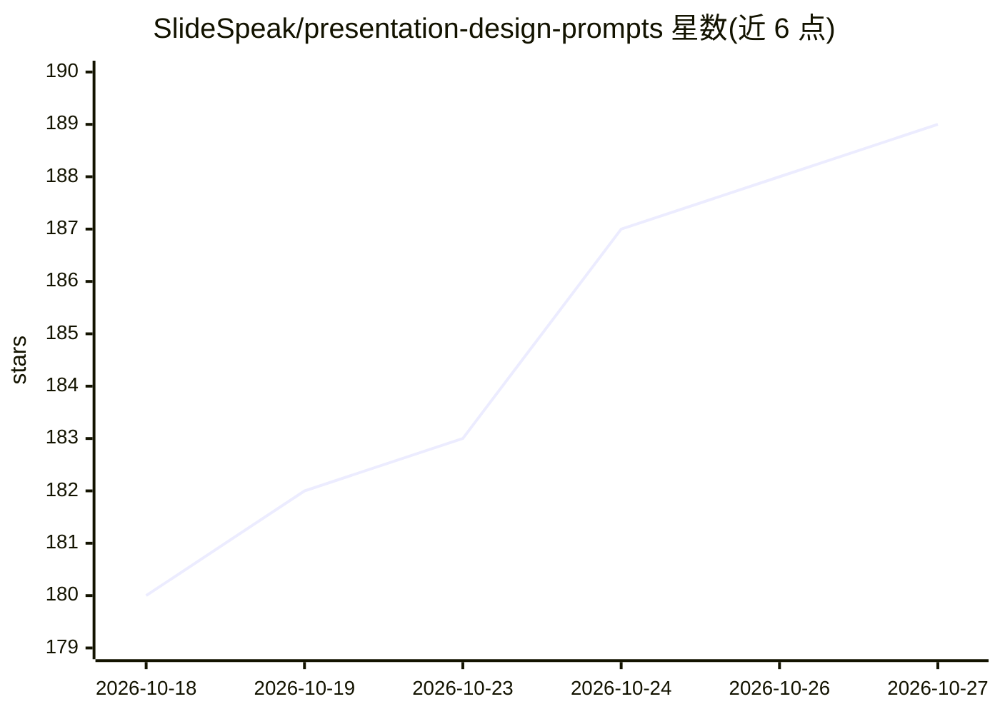

# SlideSpeak/presentation-design-prompts

⭐ 189 · MIT · 推送 2026-09-30 · [GitHub](https://github.com/SlideSpeak/presentation-design-prompts) · [官网](https://slidespeak.co/slide-design-prompts?utm-source=github) · 组织维护

**幻灯片设计提示词库：128 套主题供粘贴到 AI 聊天工具**

SlideSpeak 维护的演示文稿设计提示词集合：每套主题是一个完整设计系统的单条提示词，包含指定 hex 值的调色板、命名的 Google Fonts、版式规则与避免清单；共 128 套主题，按 pitch deck、商业战略、咨询风格、营销、科技产品、创意作品集、教育科研、活动节日、金融 9 类组织。使用方式为复制提示词粘贴到 ChatGPT 或 Claude 对话中生成幻灯片，也支持通过 SlideSpeak 生成器导出 PowerPoint 与 Google Slides。每套主题为 prompts/ 下的独立文件夹，含 README.md、PROMPT.md 与 webp 预览图。

## 筛选速览

| 维度 | 判定 | 备注 |
|---|---|---|
| AI 角色 | `ai-knowledge` | 知识聚合/清单类 |
| 许可风险 | `permissive` | MIT |
| 部署形态 | `None` |  |
| 模型依赖 | — | README 未给出锁定关系 |
| 硬件要求 | — | 无带数字的原话,不猜 |
| 安装摩擦 | `low` | 无编译、无系统依赖或容器化 |
| 成熟度 | — | 结构信号不足 |

## 能力要点

- 128 套主题，覆盖 9 类使用场景与 10 种视觉风格
- 每套主题内嵌 hex 调色板、命名 Google Fonts、版式规则与避免清单
- 颜色与字体值可替换为品牌色，版式规则保持不变
- 主题可经 SlideSpeak 生成器导出 PowerPoint 与 Google Slides

## 适用场景

- 让 ChatGPT 或 Claude 生成风格统一的演示文稿
- 按用途挑选投资路演、咨询报告或学术答辩等主题
- 替换提示词中的色值为品牌色后批量生成幻灯片

## 场景标签

`提示工程` · 领域:Agent 开发

## 证据(README 行号)

> L5: Free presentation design systems you paste into ChatGPT or Claude.
> L17: Each theme here is **one prompt** that carries a full design system: a color palette pinned to hex values, named Go
> L24: 2. **Copy the prompt** (or grab the theme's `PROMPT.md`) and paste it into a new ChatGPT or Claude chat. Answer the

## 星数曲线

2026-10-18 180 → 2026-10-27 189（+9）

---
*卡片 v1 · prompt 1.4 · 生成 2026-10-22 · 置信度 high · 依据 README sha `07244b63b6b4` · [字段定义](../../DATASET.md)*
