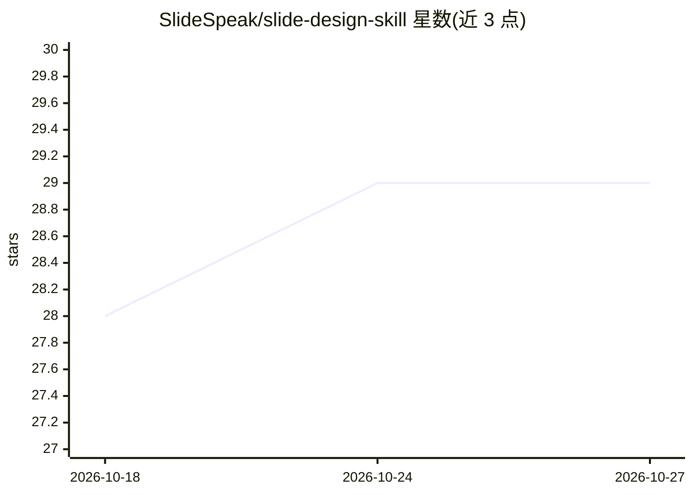

# SlideSpeak/slide-design-skill

⭐ 29 · TypeScript · MIT · 推送 2026-06-25 · [GitHub](https://github.com/SlideSpeak/slide-design-skill) · [官网](https://slidespeak.co) · 组织维护

**为 agent 提供的 AI 演示文稿引擎：从简报生成 1920×1080 HTML 幻灯片**

SlideSpeak 开发的演示文稿生成引擎，以 agent skill 形式发布：用户给出主题、内容与风格描述（自由文本、品牌 URL 或 moodboard），引擎推导专属视觉风格、规划幻灯片并渲染为 1920×1080 HTML，含真实图表、表格与图像。风格生成一次后冻结，填充由 deck LLM 完成。以代码级 quality gates 强制设计规则（风格校验、内容 lint、品牌守护、安全测试）。AI 图像通过 fal.ai 生成，需自带 FAL_KEY，无 key 也可端到端运行（不含 AI 图像）。通过 npx skills 安装到 Claude Code、Cursor、Copilot 等 coding agent。

## 筛选速览

| 维度 | 判定 | 备注 |
|---|---|---|
| AI 角色 | `ai-native` | 本体是模型或模型工具 |
| 许可风险 | `permissive` | MIT |
| 部署形态 | `library` | 以包/库形式分发 |
| 模型依赖 | — | README 未给出锁定关系 |
| 硬件要求 | — | 无带数字的原话,不猜 |
| 安装摩擦 | `low` | 无编译、无系统依赖或容器化 |
| 成熟度 | — | 结构信号不足 |

## 能力要点

- 从简报推导专属风格并渲染 1920×1080 HTML 幻灯片（含图表/表格）
- 以代码实现的 quality gates 强制设计规则（风格校验、内容 lint、品牌守护、安全测试）
- 风格一次生成后冻结、LLM 只填槽的分离机制
- AI 图像可选：设置 FAL_KEY 经 fal.ai 生成，带花费守护与缓存

## 适用场景

- 让 coding agent 直接生成 pitch deck、keynote、数据报告等幻灯片
- 从品牌 URL 或描述推导与企业风格一致的演示文稿
- 批量产出含真实图表与表格的数据报告型 deck

## 场景标签

`AI 写作` `代码生成` · 领域:编码与开发

## 证据(README 行号)

> L3: **An AI presentation engine that designs the deck for you.** Describe what your
> L9: Built by SlideSpeak to generate presentations, slide decks, pitch

## 星数曲线

2026-10-18 28 → 2026-10-27 29（+1）

---
*卡片 v1 · prompt 1.4 · 生成 2026-10-26 · 置信度 high · 依据 README sha `5055e2ad2511` · [字段定义](../../DATASET.md)*
