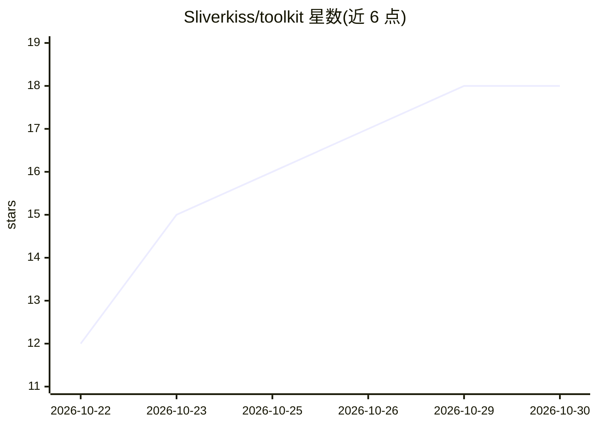

# Sliverkiss/toolkit

⭐ 18 · Go · NOASSERTION · 推送 2026-10-20 · [GitHub](https://github.com/Sliverkiss/toolkit) · 个人维护 · 中文 README

**给不支持函数调用的 LLM API 补上 tool_calls 的 Go 中间件库**

纯 Go 可嵌入中间件库，面向上游 LLM 不支持原生 function calling 的场景（自建网关、反代、本地模型服务）。机制：把工具定义以紧凑 XYML 协议块注入 system prompt，将模型文本输出解析回标准 tool_calls，筛子剥离无法解析的协议文本防止泄漏，流式场景逐段重组并在流末冲刷完整 tool_calls，含畸形恢复路径。限制：不做上游 HTTP 请求、账号池/路由/鉴权与下游协议转换，仅聚焦函数调用层。要求 Go 1.22+，唯一外部依赖 yaml.v3。许可 CC BY-NC-SA 4.0 禁止商用。

## 筛选速览

| 维度 | 判定 | 备注 |
|---|---|---|
| AI 角色 | `ai-ecosystem` | LLM/agent 周边工具 |
| 许可风险 | `none` | NOASSERTION |
| 部署形态 | `None` |  |
| 模型依赖 | — | README 未给出锁定关系 |
| 硬件要求 | — | 无带数字的原话,不猜 |
| 安装摩擦 | `low` | 无编译、无系统依赖或容器化 |
| 成熟度 | — | 结构信号不足 |

## 能力要点

- XYML 注入，支持 auto/none/required/指定函数名四种 tool_choice
- 文本→tool_calls 解析，容忍 CDATA 嵌套、标签融合等边角语法
- 筛子保证协议标记不泄漏到客户端
- 流式重组：增量下发安全内容，流末冲刷完整 tool_calls

## 适用场景

- 让不支持 function calling 的上游模型对外提供标准 tool_calls 接口
- 自建 LLM 网关中嵌入函数调用能力
- 流式输出场景下安全重组工具调用片段

## 场景标签

 · 领域:LLM 基础设施

## 证据(README 行号)

> L17: `toolkit` 是一个可嵌入的 **Go 函数调用中间件库**。当你的上游 LLM 不支持原生 function calling 时——不管是自建网关、第三方反代还是本地模型服务——toolkit 把工具定义以紧凑的 **XY
> L19: **客户端无感知**：进来的是标准 OpenAI Chat Completions（带 `tools`），出去的是标准 `tool_calls`，`role:"tool"` 的结果再喂回来即可。**上游也无感知**：它只看到普通文

## 星数曲线

2026-10-22 12 → 2026-10-30 18（+6）

---
*卡片 v1 · prompt 1.4 · 生成 2026-10-29 · 置信度 high · 依据 README sha `56f85c393d49` · [字段定义](../../DATASET.md)*
