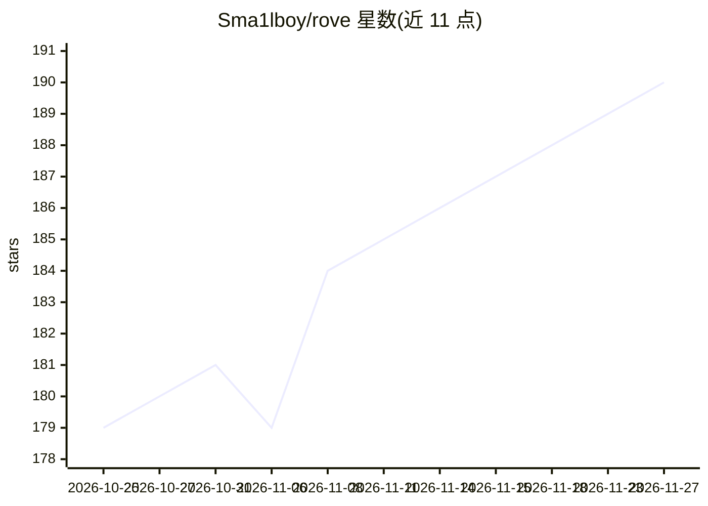

# Sma1lboy/rove

⭐ 190 · TypeScript · MIT · 推送 2026-11-26 · [GitHub](https://github.com/Sma1lboy/rove) · [官网](https://rove.run) · 个人维护

**在终端集中运行多个编码 agent 的管理环境**

面向终端的 agentic 开发环境：把 Claude Code、Codex、Copilot 等多个编码 agent CLI 并排放在一个窗口中运行，每个任务分配独立 git worktree 与分支，断开连接后 agent 在主机上继续运行并可重新接入。内置 7 个 agent 引擎，目录中另有十余个可选引擎；提供 rove api 供脚本与其他 agent 调用、插件系统扩展面板与引擎，支持 Web、iOS/Android 应用与 SSH 访问。运行依赖 Bun ≥ 1.3.11 与 git。

## 筛选速览

| 维度 | 判定 | 备注 |
|---|---|---|
| AI 角色 | `ai-ecosystem` | LLM/agent 周边工具 |
| 许可风险 | `permissive` | MIT |
| 部署形态 | `library` | 以包/库形式分发 |
| 模型依赖 | — | README 未给出锁定关系 |
| 硬件要求 | — | 无带数字的原话,不猜 |
| 安装摩擦 | `low` | 无编译、无系统依赖或容器化 |
| 成熟度 | — | 结构信号不足 |

## 能力要点

- 每个任务独立 git worktree 与分支，支持多任务并行
- 会话脱离终端存活，重开终端可查看 agent 完成的回合
- rove api 提供脚本与其他 agent 调用的任务模型
- 插件系统支持添加面板、注册引擎与命令

## 适用场景

- 在一个终端里同时管理多个编码 agent 的任务
- 某个 agent 用量到限时把任务切换给另一个引擎继续
- 通过定时提示词让 agent 无人值守执行任务

## 场景标签

`编码 Agent` · 领域:编码与开发

## 证据(README 行号)

> L5: Rove is an agentic development environment (ADE) for your terminal. Claude Code, Codex, Copilot and a dozen more wor
> L40: - **The real CLIs.** Each task picks its engine; Rove runs that CLI with its own auth, permissions and models (Engi
> L60: `rove api` gives shell scripts and coding agents the same task model:

## 星数曲线

2026-10-25 179 → 2026-11-27 190（+11）

---
*卡片 v1 · prompt 1.4 · 生成 2026-11-26 · 置信度 high · 依据 README sha `5d2ce028f2f9` · [字段定义](../../DATASET.md)*
