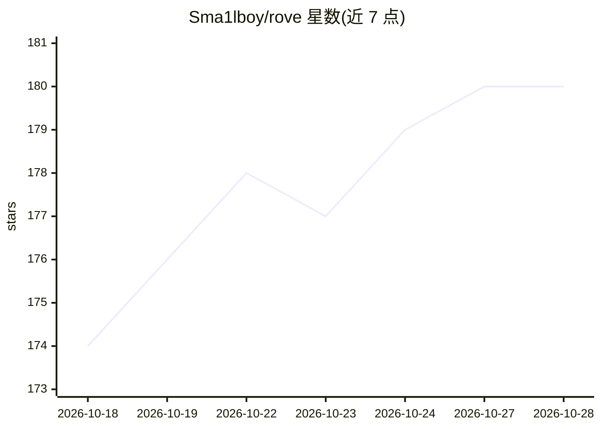

# Sma1lboy/rove

⭐ 180 · TypeScript · MIT · 推送 2026-10-27 · [GitHub](https://github.com/Sma1lboy/rove) · [官网](https://rove.run) · 个人维护

**终端里的多 agent 并行工作区：隔离 worktree 运行多个编码 agent**

终端原生（TUI）的 agent 多路复用器：在同一个仓库内并行运行多个编码任务，每个任务拥有独立的 git worktree 与分支，避免 agent 之间互相覆盖文件。内置支持 Claude Code、Codex、GitHub Copilot、Kimi Code 等十余种 agent CLI，也可注册任意命令行。会话运行在主机上，断开终端或 SSH 后 agent 继续工作，重新 attach 可查看输出。提供 rove api 供脚本与 agent 驱动任务生命周期，支持插件系统与浏览器客户端（rove --web）。运行需 Bun ≥ 1.3.11 与 git、至少一个受支持 agent CLI。

## 筛选速览

| 维度 | 判定 | 备注 |
|---|---|---|
| AI 角色 | `ai-ecosystem` | LLM/agent 周边工具 |
| 许可风险 | `permissive` | MIT |
| 部署形态 | `library` | 以包/库形式分发 |
| 模型依赖 | — | README 未给出锁定关系 |
| 硬件要求 | — | 无带数字的原话,不猜 |
| 安装摩擦 | `low` | 无编译、无系统依赖或容器化 |
| 成熟度 | — | 结构信号不足 |

## 能力要点

- 每个任务独立 git worktree 与分支的并行隔离机制
- 会话驻留主机：断开终端后 agent 持续运行，可重新 attach
- rove api 供脚本与编码 agent 创建、检查、跟进并合并任务
- 插件系统：自定义面板、事件、命令、引擎与 mods；浏览器客户端共享同一数据

## 适用场景

- 在同一仓库并行跑多个编码任务（重构、修 bug、审查）互不干扰
- SSH 到远程机器管理多个 agent 会话，断线后任务继续
- 让一个编码 agent 通过 Agent API 驱动 Rove 本身调度其他任务

## 场景标签

`多智能体` `编码 Agent` · 领域:Agent 开发

## 证据(README 行号)

> L5: Rove is a terminal-native workspace for running multiple coding tasks in parallel with Claude Code, Codex, Copilot, 
> L7: Rove isolates parallel work in git worktrees and branches, while agent and shell sessions keep running when you disc
> L44:  Every agent CLI, each in its own worktree. Built in: Claude Code, Codex, GitHub Copilot, Kimi Code, Pi, OMP. From 

## 星数曲线

2026-10-18 174 → 2026-10-28 180（+6）

---
*卡片 v1 · prompt 1.4 · 生成 2026-10-22 · 置信度 high · 依据 README sha `d1b392e0d29f` · [字段定义](../../DATASET.md)*
