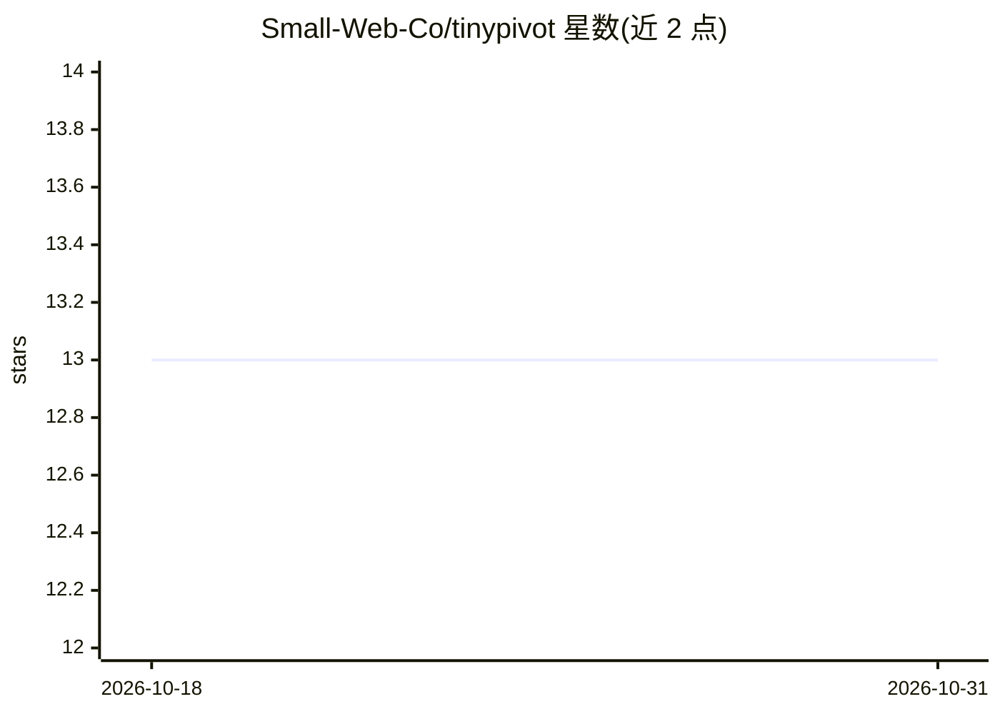

# Small-Web-Co/tinypivot

⭐ 13 · TypeScript · NOASSERTION · 推送 2026-10-24 · [GitHub](https://github.com/Small-Web-Co/tinypivot) · [官网](https://tiny-pivot.com) · 组织维护

**Vue/React 数据表格与透视表组件，Pro 版含 AI 数据分析**

面向 Vue 3 与 React 开发者的数据展示组件包：提供类 Excel 数据格、透视表（Sum 聚合/行列合计/计算字段）、CSV 导出、分页与主题等免费功能；付费 Pro 版解锁全部 9 种聚合、XLSX 导出、图表构建器与 AI Data Analyst——用户以自然语言提问，AI 生成 SQL（支持跨表 JOIN），经 PostgreSQL 后端或 DuckDB WASM 在浏览器端执行后回显到表格。AI 需 Pro License 与 BYOK（OpenAI/Anthropic/OpenRouter），数据不经过官方服务器。

## 筛选速览

| 维度 | 判定 | 备注 |
|---|---|---|
| AI 角色 | `ai-enhanced` | 去掉 AI 部分产品仍成立 |
| 许可风险 | `none` | NOASSERTION |
| 部署形态 | `library` | 以包/库形式分发 |
| 模型依赖 | locked-api |  |
| 硬件要求 | — | 无带数字的原话,不猜 |
| 安装摩擦 | `low` | 无编译、无系统依赖或容器化 |
| 成熟度 | — | 结构信号不足 |

## 能力要点

- 透视表含 Sum 聚合、行列合计、计算字段与钻取（Pro）
- AI Data Analyst（Pro）：自然语言生成 SQL，支持跨表 JOIN，BYOK 模式
- SQL 安全校验：仅 SELECT、只读会话、表白名单、函数黑名单
- Vue 3 与 React 双框架一等支持，pnpm/npm 安装

## 适用场景

- 在我的 Vue/React 应用中嵌入可透视分析的类 Excel 数据表格
- 让业务用户用自然语言查询数据库并直接看到表格结果
- 导出带样式的多级透视表 XLSX 报表（Pro）

## 场景标签

`数据分析` · 领域:效率与自动化

## 证据(README 行号)

> L3: A lightweight data grid with free pivot tables, Pro charts, and optional AI-powered data exploration for Vue 3 and R
> L233: TinyPivot Pro includes an optional AI Data Analyst that lets users explore data using natural language. Ask questi

## 星数曲线

2026-10-18 13 → 2026-10-31 13（+0）

---
*卡片 v1 · prompt 1.4 · 生成 2026-10-31 · 置信度 high · 依据 README sha `ed2ec47436c6` · [字段定义](../../DATASET.md)*
