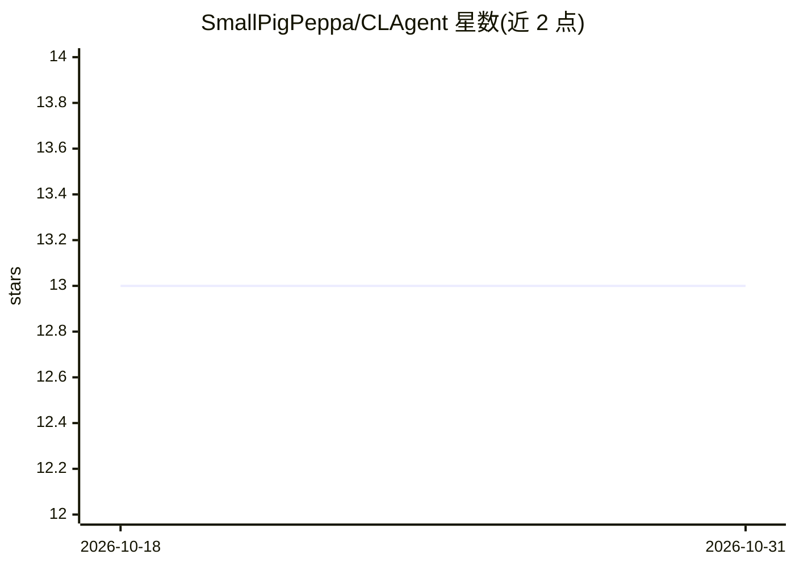

# SmallPigPeppa/CLAgent

⭐ 13 · NOASSERTION · 推送 2026-08-24 · [GitHub](https://github.com/SmallPigPeppa/CLAgent) · [官网](https://cl-agent.com) · 组织维护 · 中文 README

**持续自我进化的桌面 AI Agent 系统，任务中学习新能力**

桌面端 Agent 应用：在项目目录内运行，集终端、文件编辑器、浏览器、记忆与常驻任务于一个窗口，其余能力从应用市场安装。核心机制是持续学习：事实与偏好写入记忆，能力保存为带版本代际的 app，变更经裁决后生效且可回退；由确定性内核而非模型行为约束安全。模型来源为官方托管网关或用户自带的 OpenAI 兼容端点。本仓库仅发布文档与品牌资产，源码在私有仓库，未授予开源许可；提供 macOS（Apple Silicon）与 Windows 安装包。

## 筛选速览

| 维度 | 判定 | 备注 |
|---|---|---|
| AI 角色 | `ai-native` | 本体是模型或模型工具 |
| 许可风险 | `none` | NOASSERTION |
| 部署形态 | `desktop` | 安装包/桌面程序 |
| 模型依赖 | — | README 未给出锁定关系 |
| 硬件要求 | — | 无带数字的原话,不猜 |
| 安装摩擦 | `low` | 无编译、无系统依赖或容器化 |
| 成熟度 | — | 结构信号不足 |

## 能力要点

- 记忆/app/系统三层结构，app 按代际保存且可回退
- 权限裁决三态（allow/deny/ask）与固定检查顺序，由人授权
- Agent 在使用中自主生成新 app 并可发布到市场
- 支持 OpenAI 兼容自有端点接入模型

## 适用场景

- 在桌面项目目录中让 agent 执行终端、编辑、浏览等任务
- 让 agent 在完成任务过程中积累可复用的新能力
- 通过常驻任务执行定时或事件触发的无人值守工作

## 场景标签

`Agent 记忆` `GUI 自动化` · 领域:Agent 开发

## 证据(README 行号)

> L1: # CLAgent: A Continually Self-Evolving Agent System
> L14: CLAgent runs on the desktop and works inside the project directory on disk. A terminal, a file editor, a browser, m
> L134: First run is three steps: the package for the platform is installed from the download page; signing in through the

## 星数曲线

2026-10-18 13 → 2026-10-31 13（+0）

---
*卡片 v1 · prompt 1.4 · 生成 2026-10-31 · 置信度 high · 依据 README sha `6b3f1080fb09` · [字段定义](../../DATASET.md)*
