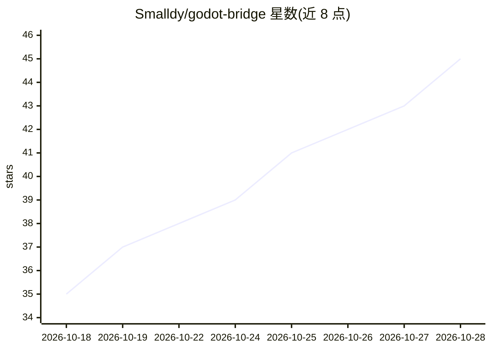

# Smalldy/godot-bridge

⭐ 46 · GDScript · MIT · 推送 2026-10-23 · [GitHub](https://github.com/Smalldy/godot-bridge) · 个人维护 · 中文 README

**DSH 插件：让 DeepSeek agent 原生驱动 Godot 4.x 游戏开发**

DeepSeek Harness (DSH) 的宿主插件，通过游戏内置的 TCP 交互服务器（127.0.0.1:9090，换行分隔 JSON 协议）启动并操控运行中的 Godot 4.x 游戏，以 17 个 godot_* 原生工具替代 godot-mcp MCP 服务器：项目启动/停止、headless 场景读写（16 种静态操作）、GDScript 校验、输入映射/导出预设/自动加载管理等，并含带调试器追踪的诊断模式。给在 DSH 环境中做 Godot 游戏开发自动化的开发者与 agent 使用；需 node 与 Godot 可执行文件，游戏侧需 McpInteractionServer 自动加载（可自动安装）。

## 筛选速览

| 维度 | 判定 | 备注 |
|---|---|---|
| AI 角色 | `ai-ecosystem` | LLM/agent 周边工具 |
| 许可风险 | `permissive` | MIT |
| 部署形态 | `None` |  |
| 模型依赖 | locked-api |  |
| 硬件要求 | — | 无带数字的原话,不猜 |
| 安装摩擦 | `low` | 无编译、无系统依赖或容器化 |
| 成熟度 | — | 结构信号不足 |

## 能力要点

- 17 个 godot_* 原生工具替代 godot-mcp MCP 服务器，无 MCP 协议与 Python 服务器
- 游戏侧协议与 godot-mcp 一致，已有工作流保持兼容
- headless 静态操作 16 种（读写场景/资源/脚本），无需运行游戏
- 诊断模式按退出码诚实分类崩溃/正常退出，返回 debuggerTrace

## 适用场景

- 在 DSH 会话中让 agent 启动并操控 Godot 游戏进行自动化测试
- agent 对 Godot 项目做 headless 场景编辑与脚本校验
- 替代 godot-mcp 获得 DSH 内的原生工具调用

## 场景标签

 · 领域:游戏开发/AI agent 工具

## 证据(README 行号)

> L8: Native **DeepSeek Harness (DSH)** plugin that launches and drives a running **Godot 4.x** game through its in-game T
> L63: dsh plugin --profile web add github:Smalldy/godot-bridge

## 星数曲线

2026-10-18 35 → 2026-10-28 45（+10）

---
*卡片 v1 · prompt 1.4 · 生成 2026-10-25 · 置信度 high · 依据 README sha `044dce34f551` · [字段定义](../../DATASET.md)*
