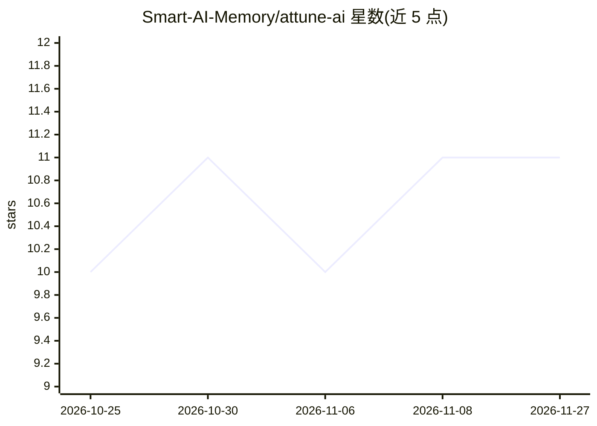

# Smart-AI-Memory/attune-ai

⭐ 11 · HTML · Apache-2.0 · 推送 2026-11-20 · [GitHub](https://github.com/Smart-AI-Memory/attune-ai) · [官网](https://attune-ai.dev) · 组织维护

**为 Claude Code 提供持久记忆与凭证验证工作流的插件/CLI**

以 pip 安装的 Claude Code 插件、MCP 服务器与 spec 驱动开发框架的组合：memory 层通过 stash→recall→promote 循环把会话中的决策、bug 与经验写入本地文件或 Redis，并在会话开始时按需召回；receipts 机制要求预先声明验收探针并独立复跑，exit 0 以探针通过为准。提供 21 个工作流、66 个 MCP 工具、交互式表单与多 LLM 协作（Claude Code/Codex/Antigravity）。插件路径运行在 Claude 订阅上，CLI 直接调用需 ANTHROPIC_API_KEY。

## 筛选速览

| 维度 | 判定 | 备注 |
|---|---|---|
| AI 角色 | `ai-ecosystem` | LLM/agent 周边工具 |
| 许可风险 | `permissive` | Apache-2.0 |
| 部署形态 | `self-host` | docker 或自建部署 |
| 模型依赖 | — | README 未给出锁定关系 |
| 硬件要求 | — | 无带数字的原话,不猜 |
| 安装摩擦 | `low` | 无编译、无系统依赖或容器化 |
| 成熟度 | — | 结构信号不足 |

## 能力要点

- 本地优先的持久记忆：stash/recall/promote 循环，Redis 为可选后端
- receipt 机制：验收探针独立复跑，agent 自述不作为证据
- 21 个工作流、66 个 MCP 工具、28 个自动触发 skills
- /roundtable 与 /cross-review 多模型协作与交叉评审

## 适用场景

- 让 agent 会话之间保留决策与踩坑经验
- 要求 agent 修复任务以可独立验证的探针结果交付
- 在 Claude Code 与 Codex 之间共享会话记忆与交接简报

## 场景标签

`Agent 记忆` `编码 Agent` `多智能体` · 领域:Agent 开发

## 证据(README 行号)

> L3: **Persistent memory and receipt-verified workflows for Claude Code.**
> L52: Around that core: 21 workflows and 66 MCP tools
> L245: As of 10.6.0, attune treats Claude Code, OpenAI Codex, and Google

## 星数曲线

2026-10-25 10 → 2026-11-27 11（+1）

---
*卡片 v1 · prompt 1.4 · 生成 2026-11-18 · 置信度 mid · 依据 README sha `16324b530960` · [字段定义](../../DATASET.md)*
