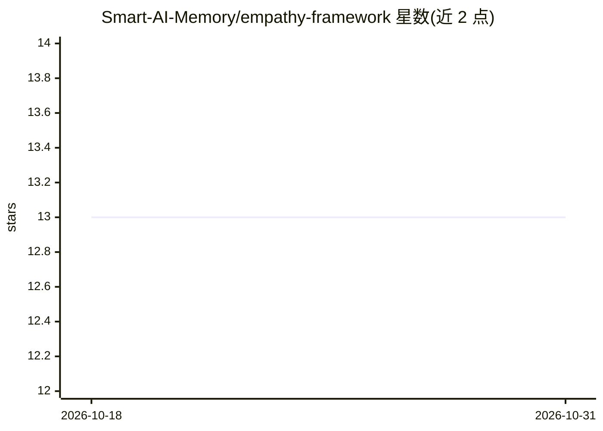

# Smart-AI-Memory/empathy-framework

⭐ 13 · HTML · Apache-2.0 · 推送 2026-04-13 · [GitHub](https://github.com/Smart-AI-Memory/empathy-framework) · [官网](https://smartaimemory.com) · 组织维护

**面向 Claude Code 的 AI 开发者工作流框架：审查、调试、测试与成本优化**

以 Python 包（empathy-framework）形式提供的开发者工作流框架，通过 CLI、Python API 与 Claude Code 命令/MCP Server 运行代码审查、调试、测试生成、安全审计、性能审计、发布准备等自动化工作流。支持多代理编排（含协调仪表盘，需 Redis）、自然语言路由到工作流（Socratic 引导式交互）、三级模型分层路由与批处理/缓存等成本优化手段，并从工作流结果中做模式学习。v5.0 起移除非 Anthropic 提供商，专注 Claude 原生架构。

## 筛选速览

| 维度 | 判定 | 备注 |
|---|---|---|
| AI 角色 | `ai-ecosystem` | LLM/agent 周边工具 |
| 许可风险 | `permissive` | Apache-2.0 |
| 部署形态 | `library` | 以包/库形式分发 |
| 模型依赖 | locked-api |  |
| 硬件要求 | — | 无带数字的原话,不猜 |
| 安装摩擦 | `low` | 无编译、无系统依赖或容器化 |
| 成熟度 | — | 结构信号不足 |

## 能力要点

- CLI / Python / Claude Code 命令 / MCP Server（10 个工具）多种使用方式
- 三级模型分层路由、批处理 API 与缓存监控等成本优化
- 多代理协调仪表盘（心跳、事件流、审批门，需 Redis）
- 从工作流结果中学习的模式学习机制

## 适用场景

- 在终端或 Claude Code 中运行代码审查、安全审计与测试生成
- 通过自然语言描述需求自动路由到对应工作流
- 追踪并优化 LLM API 调用成本（分层路由、缓存、批处理）
- 编排多代理团队完成发布准备等任务

## 场景标签

`工作流自动化` `代码审查` `编码 Agent` · 领域:效率与自动化

## 证据(README 行号)

> L5: Run code review, debugging, testing, and release workflows from your terminal or Claude Code. Smart tier routing sav
> L215: **MCP Server Integration (v5.1.1+):**
> L246: ```python

## 星数曲线



2026-10-18 13 → 2026-10-31 13（+0）


---
*卡片 v1 · prompt 1.4 · 生成 2026-10-31 · 置信度 high · 依据 README sha `d6ec7e874e33` · [字段定义](../../DATASET.md)*
