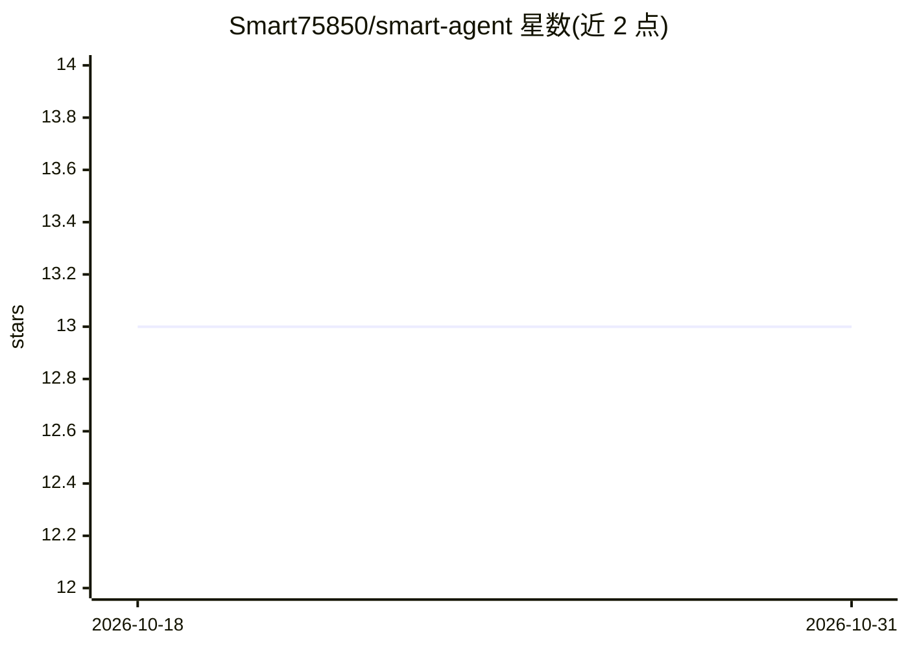

# Smart75850/smart-agent

⭐ 13 · Python · NOASSERTION · 推送 2026-10-06 · [GitHub](https://github.com/Smart75850/smart-agent) · 个人维护 · 中文 README

**7 平台社媒数据采集与 7 Agent 内容分析引擎**

输入关键词后自动搜索知乎/B站/小红书/抖音/快手/微博/贴吧 7 个平台，由 7 个专业 Agent（趋势、竞品、情绪、文案等）输出结构化分析报告。采集层区分纯 HTTP 与 CDP 浏览器两种方式，支持断点续跑与 6 种存储后端；分析层由 LangGraph DAG 编排，每个 Agent 内置 Critic 自修正循环，无 API Key 时降级为模板模式。另提供 MCP Server（30+ 工具，供 Claude Desktop/Cursor 调用）、Go 单文件二进制、WebUI 与 Docker 部署。限学习与学术研究用途，另有闭源 Pro 版。

## 筛选速览

| 维度 | 判定 | 备注 |
|---|---|---|
| AI 角色 | `ai-native` | 本体是模型或模型工具 |
| 许可风险 | `none` | NOASSERTION |
| 部署形态 | `library` | 以包/库形式分发 |
| 模型依赖 | locked-api |  |
| 硬件要求 | — | 无带数字的原话,不猜 |
| 安装摩擦 | `low` | 无编译、无系统依赖或容器化 |
| 成熟度 | — | 结构信号不足 |

## 能力要点

- 7 平台搜索/热榜/详情/评论/用户采集，纯 HTTP 或 CDP 浏览器两种方式
- 7 个专业 Agent 并联分析，每个内置 Critic 自修正循环
- MCP Server 提供 30+ 工具，Claude Desktop/Cursor/Hermes 可自然语言调用
- 无 API Key 时自动降级为模板模式

## 适用场景

- 输入关键词获取跨平台内容趋势与用户情绪报告
- 让 Claude Desktop 通过对话调用各平台采集与文案生成工具
- 对比不同平台同话题热度与竞品内容策略

## 场景标签

`网页抓取` `数据分析` `AI 写作` · 领域:效率与自动化

## 证据(README 行号)

> L11: **输入一个关键词，自动搜索知乎/B站/小红书/抖音等 7 个平台，7 个 AI Agent 并联分析爆款趋势、竞品策略、用户情绪，输出结构化报告。**
> L65: > 每个 Agent 内置 CriticAgent 自修正 — review-retry loop，输出质量把关。
> L97: - DeepSeek V4 API（LLM 驱动全部分析）

## 星数曲线

2026-10-18 13 → 2026-10-31 13（+0）

---
*卡片 v1 · prompt 1.4 · 生成 2026-10-31 · 置信度 mid · 依据 README sha `5d9182d5c8df` · [字段定义](../../DATASET.md)*
