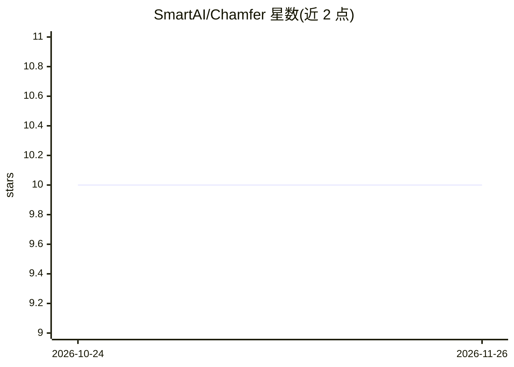

# SmartAI/Chamfer

⭐ 10 · TypeScript · NOASSERTION · 推送 2026-07-25 · [GitHub](https://github.com/SmartAI/Chamfer) · [官网](https://chamferonline.com) · 个人维护

**文本/图像生成参数化 3D CAD 模型的 AI Agent 工具**

Chamfer 将一句话或参考图像转为可检视、可导出的参数化 3D 模型：Agent 编写 build123d Python 并在几何内核上运行，随后对构建结果做尺寸、孔位、实体数等测量校验，通过后才交付。支持本地 build123d 与 Autodesk Fusion 两种 CAD 后端，可自动探测运行中的 Fusion MCP 端点；支持接入自有的 Anthropic/OpenAI/Google API key；可从查看器导出 STL/OBJ/GLB；提供在线版本与本地 CLI，会话与设置保存在本机。

## 筛选速览

| 维度 | 判定 | 备注 |
|---|---|---|
| AI 角色 | `ai-native` | 本体是模型或模型工具 |
| 许可风险 | `none` | NOASSERTION |
| 部署形态 | `library` | 以包/库形式分发 |
| 模型依赖 | locked-api |  |
| 硬件要求 | — | 无带数字的原话,不猜 |
| 安装摩擦 | `low` | 无编译、无系统依赖或容器化 |
| 成熟度 | — | 结构信号不足 |

## 能力要点

- 几何内核校验输出：多视图渲染与尺寸测量后再交付
- 文本与图像提示，双 CAD 后端（本地 build123d / Autodesk Fusion）
- 支持自带 Anthropic、OpenAI、Google API key
- 从查看器导出 STL、OBJ、GLB

## 适用场景

- 用一句话或产品照片生成可导出的参数化 3D 模型
- 在本地通过 MCP 驱动正在运行的 Autodesk Fusion 会话建模
- 数据不出本机的本地优先 CAD 生成流程

## 场景标签

`代码生成` · 领域:编码与开发

## 证据(README 行号)

> L9: Chamfer turns a sentence or a reference image into a real, parametric 3D model you can inspect and export.
> L11: It is an AI agent that writes build123d Python, runs it on a real geometry kernel, and then measures what it built 

## 星数曲线

2026-10-24 10 → 2026-11-26 10（+0）

---
*卡片 v1 · prompt 1.4 · 生成 2026-11-20 · 置信度 high · 依据 README sha `3d623d4cbfc8` · [字段定义](../../DATASET.md)*
