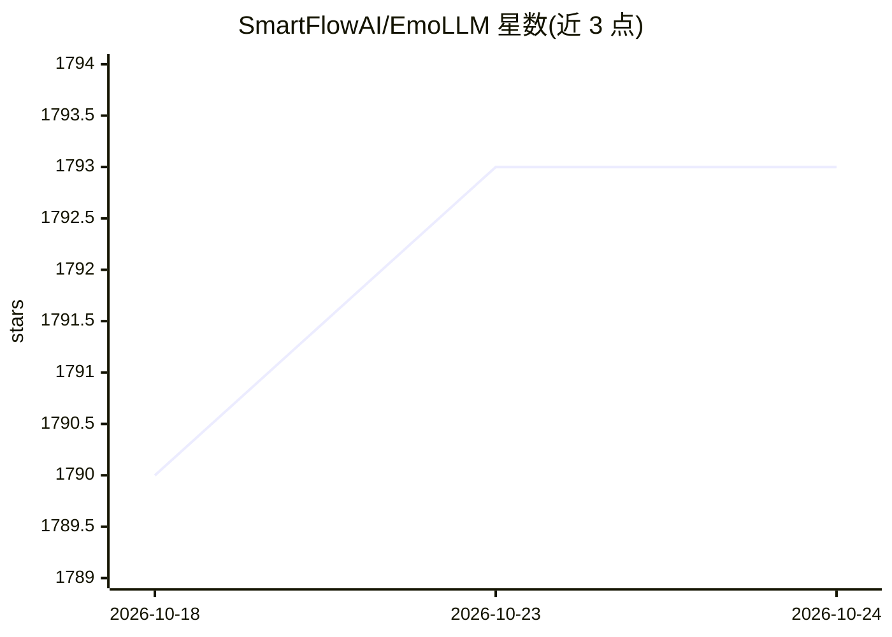

# SmartFlowAI/EmoLLM

⭐ 1,793 · Python · MIT · 推送 2026-06-18 · [GitHub](https://github.com/SmartFlowAI/EmoLLM) · [官网](https://openxlab.org.cn/apps/detail/chg0901/EmoLLMV3.0) · 组织维护 · 中文 README

**面向心理健康辅导的开源中文大模型及微调/数据/评测全链路仓库**

由高校学生团队（SmartFlowAI/EmoLLM Team）维护的心理健康大模型项目：基于 InternLM2、Qwen、Baichuan2、ChatGLM3、DeepSeek MoE、Mixtral、LLaMA3 等基座做全量/LoRA/QLoRA 微调，模型权重发布在 OpenXLab、ModelScope、Hugging Face。仓库同时提供数据集构建、增量预训练与微调指南（xtuner/ms-swift/LLaMA-Factory）、LMDeploy 量化部署、RAG pipeline 与通用/专业评测方法，并有 AI 心理助手数字人分项（深度思考+RAG+web search+TTS）。免责声明指出模型仅提供情绪支持，不能替代专业心理咨询或治疗。

## 筛选速览

| 维度 | 判定 | 备注 |
|---|---|---|
| AI 角色 | `ai-native` | 本体是模型或模型工具 |
| 许可风险 | `permissive` | MIT |
| 部署形态 | `None` |  |
| 模型依赖 | local-ok | 支持本地模型 |
| 硬件要求 | — | 无带数字的原话,不猜 |
| 安装摩擦 | `low` | 无编译、无系统依赖或容器化 |
| 成熟度 | — | 结构信号不足 |

## 能力要点

- 覆盖 15+ 基座模型的全量/LoRA/QLoRA 微调配置，权重托管于 OpenXLab/ModelScope
- 含数据集构建、增量预训练、微调、量化部署（LMDeploy）与 RAG pipeline
- 多轮对话数据集 CPsyCounD 及专业评测方法已公开（2024 ACL findings）
- AI 心理数字人分项（深度思考、RAG、web search、TTS）

## 适用场景

- 下载心理健康辅导微调模型用于情绪支持对话
- 按微调指南在自有基座上复现或继续训练心理健康模型
- 使用其数据集与评测方法做心理咨询对话研究

## 场景标签

`微调` `模型训练` `模型评测` `RAG` · 领域:评测与运维

## 证据(README 行号)

> L27: **EmoLLM** 是一系列能够支持 **理解用户-支持用户-帮助用户** 心理健康辅导链路的心理健康大模型，由 `LLM`指令微调而来，欢迎大家star~⭐⭐。目前已经开源的 `LLM` 微调配置如下：
> L175: - 【基于xtuner】全量、LoRA、QLoRA微调详见微调指南
> L292: EmoLLM 目前仅能提供情绪支持和相关建议服务，尚无法提供专业的心理咨询和心理治疗服务。EmoLLM 不能替代专业的心理医生或心理咨询师，可能存在固有局限性，并可能生成错误的、有害的、冒犯性的或其他不良输出。在关键或高风险场景

## 星数曲线

2026-10-18 1,790 → 2026-10-24 1,793（+3）

---
*卡片 v1 · prompt 1.4 · 生成 2026-10-21 · 置信度 high · 依据 README sha `c9235217ef8e` · [字段定义](../../DATASET.md)*
