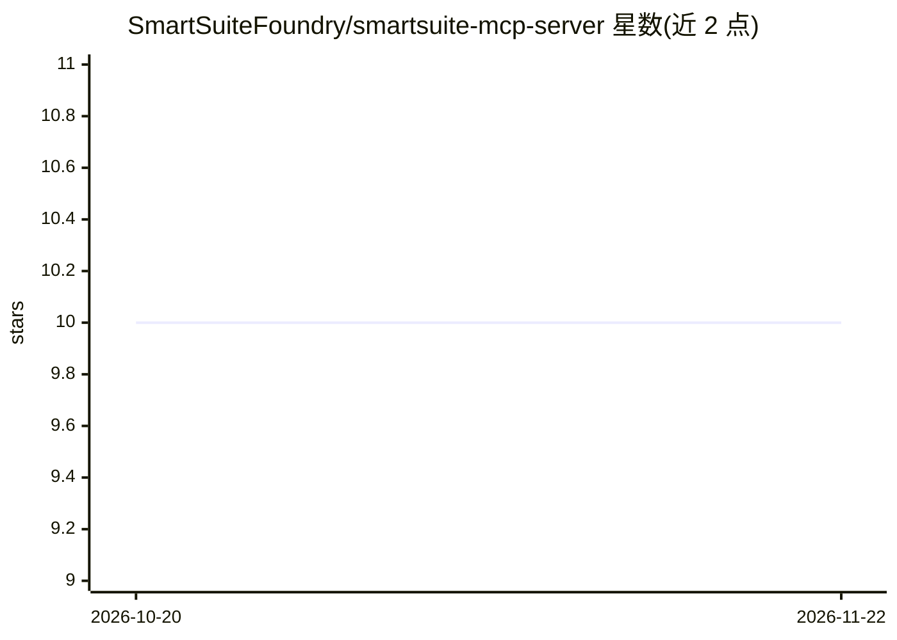

# SmartSuiteFoundry/smartsuite-mcp-server

⭐ 10 · TypeScript · MIT · 推送 2026-09-11 · [GitHub](https://github.com/SmartSuiteFoundry/smartsuite-mcp-server) · 组织维护

**让 AI 客户端以受治理方式访问 SmartSuite 数据的本地 MCP 服务器**

本地运行的 Model Context Protocol 服务器，通过 stdio 与 MCP 客户端通信，代理请求到 SmartSuite REST API。提供访问模式控制（readonly/readwrite/admin）、输入校验、日志脱敏、写操作审计日志、方案/应用白名单与跨工作区只读访问等治理机制。工具覆盖发现、模式（schema）、公式、记录、评论等操作，删除、恢复与 schema 写入需单独 opt-in。提供 .mcpb 扩展、npm 全局安装、npx 免安装和 Docker 四种方式。

## 筛选速览

| 维度 | 判定 | 备注 |
|---|---|---|
| AI 角色 | `ai-ecosystem` | LLM/agent 周边工具 |
| 许可风险 | `permissive` | MIT |
| 部署形态 | `desktop` | 安装包/桌面程序 |
| 模型依赖 | — | README 未给出锁定关系 |
| 硬件要求 | — | 无带数字的原话,不猜 |
| 安装摩擦 | `low` | 无编译、无系统依赖或容器化 |
| 成熟度 | — | 结构信号不足 |

## 能力要点

- 三种访问模式（readonly/readwrite/admin），默认 readonly，删除与 schema 写入需 opt-in
- 方案/应用白名单在每次工具调用上集中强制执行，allowlist 激活时禁用 get_file_url
- 跨工作区访问仅限只读，可用 SMARTSUITE_ALLOWED_WORKSPACES 限制可达集合
- 公式工具支持依赖图、Mermaid 图与跨表影响分析，schema 写入支持 dry-run 预览

## 适用场景

- 让 Claude Desktop/Claude Code 等 MCP 客户端读写 SmartSuite 记录
- 以只读模式让 AI 助手查询公司数据并生成审计日志
- 通过白名单限定 AI 可访问的方案与应用范围
- 用 AI 代理批量创建或迁移 SmartSuite 表与字段

## 场景标签

 · 领域:AI 基础设施/MCP 工具服务

## 证据(README 行号)

> L3: A locally-hosted Model Context Protocol (MCP) server that gives AI coding agents and desktop assistants governed, au
> L9: The SmartSuite MCP server runs on your machine and communicates with your MCP client over stdio. It proxies requests

## 星数曲线

2026-10-20 10 → 2026-11-22 10（+0）

---
*卡片 v1 · prompt 1.4 · 生成 2026-11-20 · 置信度 high · 依据 README sha `fa668afb6a74` · [字段定义](../../DATASET.md)*
