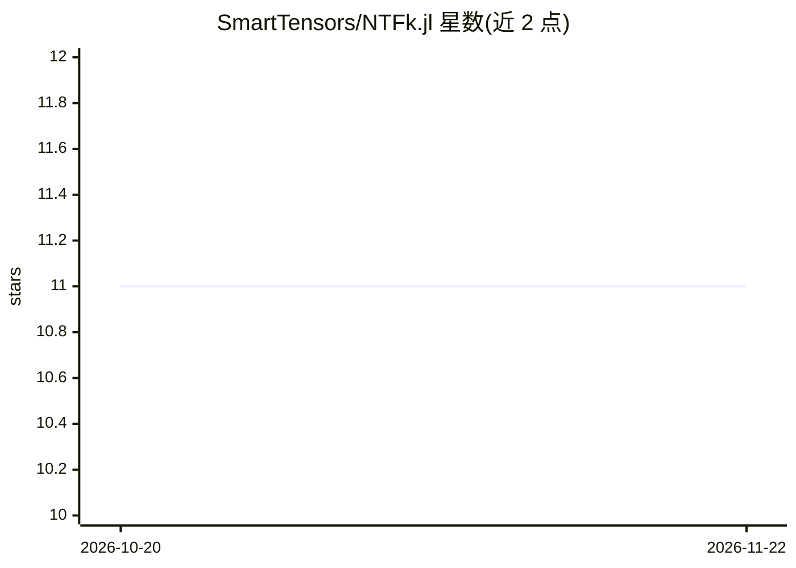

# SmartTensors/NTFk.jl

⭐ 11 · Julia · GPL-3.0 · 推送 2026-09-15 · [GitHub](https://github.com/SmartTensors/NTFk.jl) · [官网](https://smarttensors.github.io) · 组织维护

**科研用户的张量分解与秩估计 Julia 机器学习库**

NTFk.jl 是 Julia 包，结合非负张量分解、稀疏与物理约束、重复分解和 k-means 聚类，从多维数据提取潜在结构并估计因子数目；支持 CP 与 Tucker 模型，Tucker 可沿各维度分别估计秩。通过探索候选秩、比较重复解、依据重构质量与聚类稳定性选出稳健模型。属 SmartTensors 框架的一部分，要求 Julia 1.12+，可通过 Julia 包管理器安装，也提供 Docker 镜像。

## 筛选速览

| 维度 | 判定 | 备注 |
|---|---|---|
| AI 角色 | `ai-native` | 本体是模型或模型工具 |
| 许可风险 | `viral` | GPL-3.0 |
| 部署形态 | `self-host` | docker 或自建部署 |
| 模型依赖 | — | README 未给出锁定关系 |
| 硬件要求 | — | 无带数字的原话,不猜 |
| 安装摩擦 | `low` | 无编译、无系统依赖或容器化 |
| 成熟度 | — | 结构信号不足 |

## 能力要点

- 支持 CP 与 Tucker 分解，Tucker 可按维度估计秩
- 候选秩探索 + 重复分解 + 聚类稳定性选模
- 支持稀疏性、非负性与物理约束
- 多核/多处理器并行（Julia 共享与分布式数组）

## 适用场景

- 对多维数据做无监督特征提取与盲源分离
- 分析地下水、气候、地震等模拟与观测数据
- 估计数据张量的未知秩（维数）
- 构建降阶/代理模型并发现输入输出依赖

## 场景标签

 · 领域:科学计算/机器学习

## 证据(README 行号)

> L5: **NTFk.jl** is a Julia package for extracting latent structure from multidimensional
> L22: NTFk supports CP (CANDECOMP/PARAFAC) and Tucker decomposition models and can be
> L90: NTFk decomposes a data tensor into a compact set of interpretable factors. It

## 星数曲线

2026-10-20 11 → 2026-11-22 11（+0）

---
*卡片 v1 · prompt 1.4 · 生成 2026-11-18 · 置信度 high · 依据 README sha `febd8bfddedf` · [字段定义](../../DATASET.md)*
