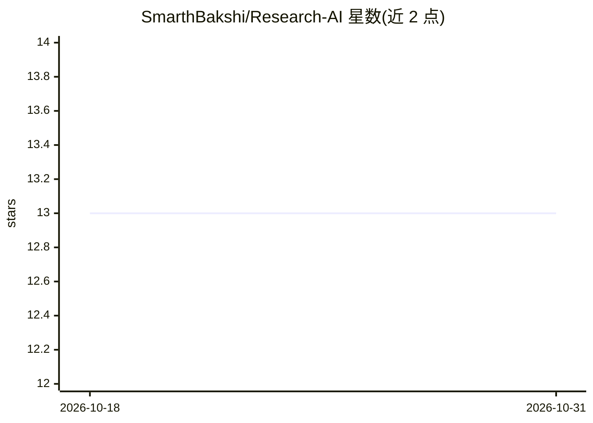

# SmarthBakshi/Research-AI

⭐ 13 · Python · MIT · 推送 2026-02-15 · [GitHub](https://github.com/SmarthBakshi/Research-AI) · 个人维护

**arXiv 论文端到端 RAG 问答系统：摄取、索引与带引用的语义问答**

面向科研文献的完整 RAG 系统：用 Airflow DAG 从 arXiv 拉取 PDF，经 PDFMiner/Tesseract OCR 提取文本并分块，用 Sentence-BERT（e5-base-v2）生成嵌入，写入 OpenSearch 支持 BM25+稠度向量混合检索；由 Ollama（llama3.2）本地推理生成带引用的回答。以 8 个 Docker 微服务组成（PostgreSQL、MinIO、Airflow、FastAPI、Gradio UI 等），docker-compose 一键部署；推荐 16GB+ 内存与 50GB+ 磁盘。提供 REST API 与网页界面，p95 查询延迟 1.3s（10K 论文基准）。

## 筛选速览

| 维度 | 判定 | 备注 |
|---|---|---|
| AI 角色 | `ai-native` | 本体是模型或模型工具 |
| 许可风险 | `permissive` | MIT |
| 部署形态 | `self-host` | docker 或自建部署 |
| 模型依赖 | local-ok | 支持本地模型 |
| 硬件要求 | — | 无带数字的原话,不猜 |
| 安装摩擦 | `low` | 无编译、无系统依赖或容器化 |
| 成熟度 | — | 结构信号不足 |

## 能力要点

- Airflow DAG 驱动的 arXiv PDF 幂等摄取流水线
- BM25+稠度向量混合检索（OpenSearch）与 OCR 兜底解析
- Ollama 本地 LLM 生成带引用回答
- docker-compose 一键部署 8 个微服务，含 Gradio UI 与 FastAPI

## 适用场景

- 对 arXiv 论文集做语义搜索与带引用的问答
- 搭建自己的科研文献知识库问答服务
- 作为生产级 RAG/MLOps 架构参考实现

## 场景标签

`文档问答` `RAG` `科研工具` · 领域:知识与检索

## 证据(README 行号)

> L8: An end-to-end **Retrieval-Augmented Generation (RAG) system** for scientific papers from arXiv. Built with productio
> L20: - 💬 **LLM-Powered Q&A**: Ollama integration for grounded answer generation
> L21: - 🎨 **Interactive UI**: Gradio web interface with real-time query answering

## 星数曲线

2026-10-18 13 → 2026-10-31 13（+0）

---
*卡片 v1 · prompt 1.4 · 生成 2026-10-31 · 置信度 high · 依据 README sha `9201a7c2c6d8` · [字段定义](../../DATASET.md)*
