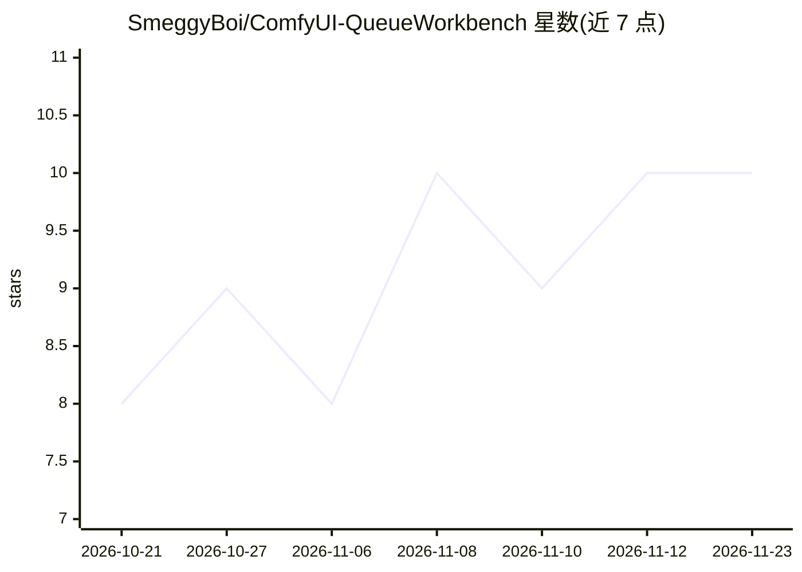

# SmeggyBoi/ComfyUI-QueueWorkbench

⭐ 10 · JavaScript · MIT · 推送 2026-10-28 · [GitHub](https://github.com/SmeggyBoi/ComfyUI-QueueWorkbench) · 个人维护

**ComfyUI 队列管理面板：区分/编辑/重排/持久化排队任务**

一个 ComfyUI 自定义节点，提供队列面板：按工作流颜色条纹与设置芯片区分同工作流的多条排队任务，悬停查看全部输入图、种子与完整提示词；支持原地编辑排队任务、拖拽重排、暂停/删除，历史记录保留最近 200 条完成任务并提供画廊、两任务对比与词级提示词 diff。排队任务通过本地 SQLite 文件持久化，重启后可恢复。GPU 显存不足失败的任务自动重排一次，可选 ntfy 推送通知，并提供基于最近运行的任务用时中位数的时间预估。安装后无 Python 依赖。

## 筛选速览

| 维度 | 判定 | 备注 |
|---|---|---|
| AI 角色 | `ai-ecosystem` | LLM/agent 周边工具 |
| 许可风险 | `permissive` | MIT |
| 部署形态 | `None` |  |
| 模型依赖 | — | README 未给出锁定关系 |
| 硬件要求 | — | 无带数字的原话,不猜 |
| 安装摩擦 | `low` | 无编译、无系统依赖或容器化 |
| 成熟度 | — | 结构信号不足 |

## 能力要点

- 排队任务原地编辑：改动可复制到同工作流其他任务并回写工作流
- SQLite 持久化，重启或崩溃后可恢复未完成任务
- 最近 200 条历史记录，支持画廊视图、任务对比与提示词 diff
- GPU 显存不足失败任务自动重排一次；可选 ntfy 推送

## 适用场景

- 批量出图时区分同工作流不同参数的排队任务
- 不重新排队就修改排队任务中的提示词、种子或参数
- 长时间无人值守跑队列，手机接收完成通知
- 重启后找回未完成的排队任务

## 场景标签

`图像生成` · 领域:内容生成

## 证据(README 行号)

> L3: A queue panel for ComfyUI that lets you see what's actually in your queue, tell
> L45: - **Survives restarts.** Pending and paused runs are mirrored to a local SQLite

## 星数曲线

2026-10-21 8 → 2026-11-23 10（+2）

---
*卡片 v1 · prompt 1.4 · 生成 2026-11-20 · 置信度 high · 依据 README sha `73d8380828cf` · [字段定义](../../DATASET.md)*
