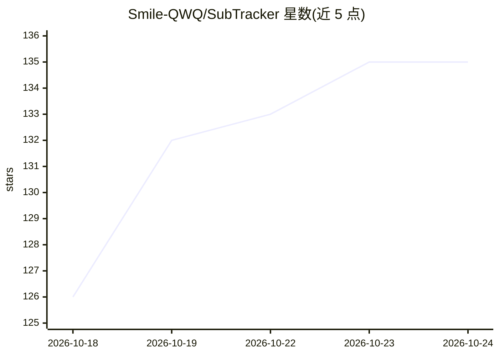

# Smile-QWQ/SubTracker

⭐ 135 · TypeScript · GPL-3.0 · 推送 2026-10-04 · [GitHub](https://github.com/Smile-QWQ/SubTracker) · 个人维护 · 中文 README

**自托管订阅管理器：订阅、提醒、预算统计与 AI 辅助录入**

自托管 Web 应用，管理订阅的全生命周期（新建/续订/暂停/恢复）、终身买断购买、多渠道通知提醒（Webhook/邮件/Telegram 等十种）、多币种归一化的支出统计与预算、日历视图、备份与 Wallos 迁移。AI 部分提供文本/图片提取订阅信息到表单及统计页 AI 摘要，支持 OpenAI/Claude/Gemini API 及供应商预设。技术栈为 Vue 3 + Fastify + Prisma + SQLite，通过安装脚本或 Docker Compose 部署，发布镜像支持 x86 与 ARM。

## 筛选速览

| 维度 | 判定 | 备注 |
|---|---|---|
| AI 角色 | `ai-enhanced` | 去掉 AI 部分产品仍成立 |
| 许可风险 | `viral` | GPL-3.0 |
| 部署形态 | `desktop` | 安装包/桌面程序 |
| 模型依赖 | locked-api |  |
| 硬件要求 | — | 无带数字的原话,不猜 |
| 安装摩擦 | `low` | 无编译、无系统依赖或容器化 |
| 成熟度 | — | 结构信号不足 |

## 能力要点

- 订阅/终身买断管理与多标签、批量操作
- 多币种归一化统计、多类型预算与消费趋势分析
- 十种通知渠道的灵活续订提醒规则
- AI 从文本/图片提取订阅信息并生成统计摘要（OpenAI/Claude/Gemini）

## 适用场景

- 集中管理我的各类订阅与续订提醒
- 按月度和标签控制订阅支出预算
- 从 Wallos 迁移历史订阅数据到自托管实例

## 场景标签

`文档解析` · 领域:知识与检索

## 证据(README 行号)

> L74: - **AI assistance**: extract subscription details from text or images into the form, and generate an AI summary on 
> L5:  Manage subscriptions, renewal reminders, budgets, logos, and Wallos migrations in one self-hosted dashboard.

## 星数曲线

2026-10-18 126 → 2026-10-24 135（+9）

---
*卡片 v1 · prompt 1.4 · 生成 2026-10-22 · 置信度 high · 依据 README sha `382078f51877` · [字段定义](../../DATASET.md)*
