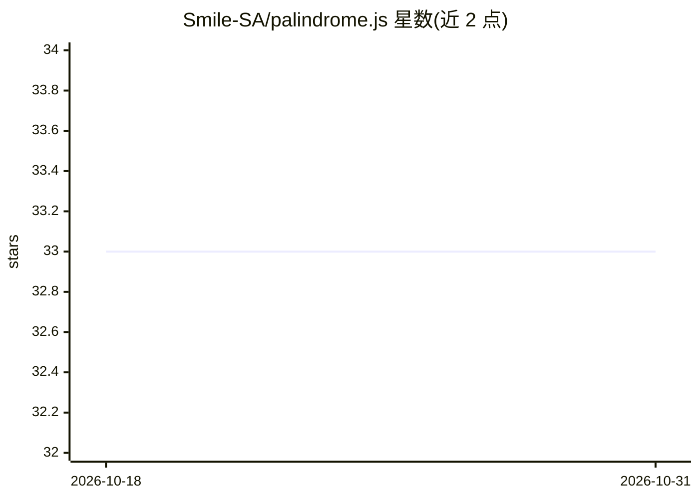

# Smile-SA/palindrome.js

⭐ 33 · JavaScript · NOASSERTION · 推送 2026-08-26 · [GitHub](https://github.com/Smile-SA/palindrome.js) · [官网](https://smile-sa.github.io/palindrome.js/storybook) · 组织维护

**给系统监控场景的 three.js 3D 可视化探针库**

基于 three.js 的 JavaScript 库，将系统指标与 KPI 以分层的 3D 信息集呈现，用于实时系统或其他数据源的监控可视化；支持修改或添加自定义算法、视觉行为、样式与配色方案。可嵌入更大的 BI 仪表盘，也可作为计算机视觉工作流的信号源。自述为研究原型，API 可能随版本变化；发表于 IEEE ECO 2024 workshop 并在 OSMC 2024 展示。需要 Node.js 20+，也可直接使用 artifacts 目录中已构建的文件。

## 筛选速览

| 维度 | 判定 | 备注 |
|---|---|---|
| AI 角色 | `ai-enhanced` | 去掉 AI 部分产品仍成立 |
| 许可风险 | `none` | NOASSERTION |
| 部署形态 | `self-host` | docker 或自建部署 |
| 模型依赖 | — | README 未给出锁定关系 |
| 硬件要求 | — | 无带数字的原话,不猜 |
| 安装摩擦 | `low` | 无编译、无系统依赖或容器化 |
| 成熟度 | `idea` | |

## 能力要点

- three.js 渲染的分层 3D 指标/KPI 监控可视化
- 自定义算法、视觉行为、样式与配色可修改或添加
- 提供已构建版本可直接集成，无需 Node.js 环境
- 可用作计算机视觉工作流的信号源

## 适用场景

- 为实时系统做 3D 监控可视化，识别指标间关系与趋势
- 嵌入 BI 仪表盘作为可视化组件
- 比较多租户数据组的差异与相似性

## 场景标签

 · 领域:监控/数据可视化

## 证据(README 行号)

> L8: ```Palindrome.js``` is a ```three.js``` based library which provides 3D monitoring for system metrics and KPIs.
> L27: dashboard, or as the signal source for a computer-vision based workflow.

## 星数曲线



2026-10-18 33 → 2026-10-31 33（+0）


---
*卡片 v1 · prompt 1.4 · 生成 2026-10-26 · 置信度 low · 依据 README sha `77859fb93206` · [字段定义](../../DATASET.md)*
