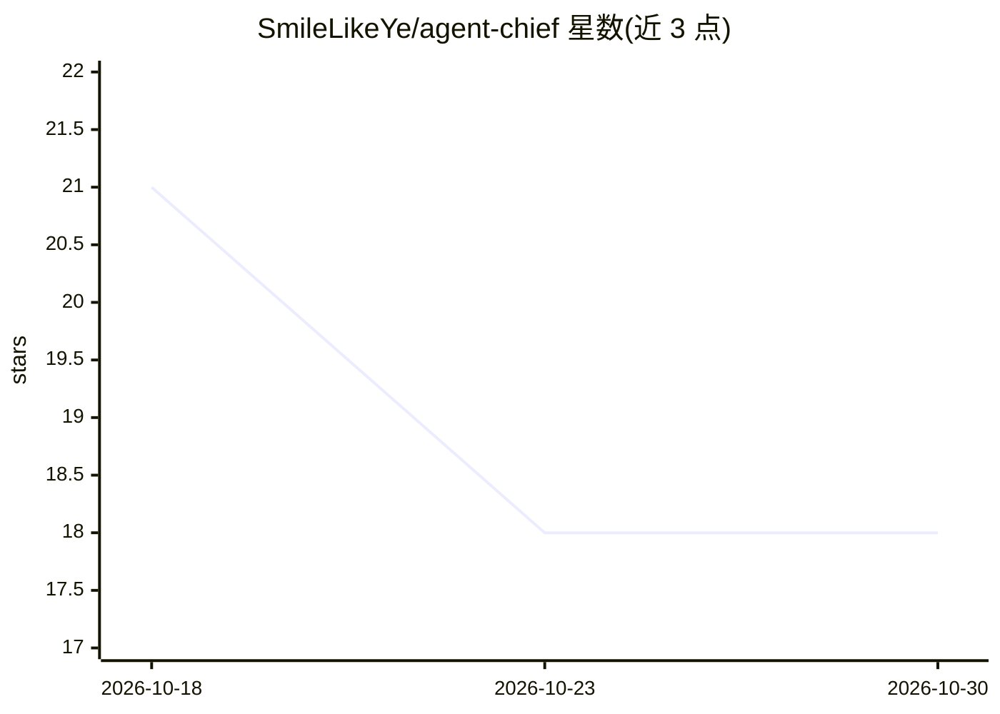

# SmileLikeYe/agent-chief

⭐ 18 · Python · MIT · 推送 2026-08-07 · [GitHub](https://github.com/SmileLikeYe/agent-chief) · [官网](https://smileflow.cn/) · 个人维护 · 中文 README

**本地优先的注意力守门层：把 agent/CI/RSS 事件裁决为打断或静默**

运行在用户与各类事件源（agent、CI、心跳、RSS）之间的本地守护层：事件经三阶段裁决（硬规则→相似度分类→可插拔 LLM 判定，支持 Ollama/DeepSeek/Anthropic/OpenAI），最终仅执行打断、派发或存档三类动作之一。按场景（睡眠/深工作/会议/通勤）设定打断阈值，前 7 天为影子模式不真正打断。数据存于本地 SQLite + markdown，👍/👎 反馈训练偏好并蒸馏为可编辑的 POLICY.md。以 PyPI 包提供 `chief` 命令，附 418 项离线测试与多种评测命令。

## 筛选速览

| 维度 | 判定 | 备注 |
|---|---|---|
| AI 角色 | `ai-ecosystem` | LLM/agent 周边工具 |
| 许可风险 | `permissive` | MIT |
| 部署形态 | `library` | 以包/库形式分发 |
| 模型依赖 | local-ok | 支持本地模型 |
| 硬件要求 | — | 无带数字的原话,不猜 |
| 安装摩擦 | `low` | 无编译、无系统依赖或容器化 |
| 成熟度 | — | 结构信号不足 |

## 能力要点

- 三阶段裁决漏斗：硬规则(µs)→相似度分类(ms)→LLM 判定（可插拔后端）
- 场景感知打断阈值（睡眠/深工作/会议/通勤）与前 7 天影子模式
- 👍/👎 反馈训练偏好，夜间蒸馏为人类可读可编辑的 POLICY.md
- 本地优先：单个 SQLite 文件 + markdown，无托管服务与遥测；418 项离线测试与 100 用户队列评测

## 适用场景

- 心跳 agent 的零信息报告过多时自动丢弃，只留真正值得打断的事件
- 把 CI、RSS、watcher 等多来源事件汇成单一裁决通道（POST /v1/events 或 MCP propose）
- 按作息场景控制 agent 与告警的打扰时机
- 派发工作给 agent 并在汇报前验证结果是否完成

## 场景标签

 · 领域:LLM/Agent 基础设施

## 证据(README 行号)

> L27: Chief sits between you and everything that wants your attention — agents,
> L209:  → LLM judge (pluggable: **Ollama local**, DeepSeek, Anthropic, OpenAI).

## 星数曲线

2026-10-18 21 → 2026-10-30 18（-3）

---
*卡片 v1 · prompt 1.4 · 生成 2026-10-29 · 置信度 high · 依据 README sha `e7c38a9da006` · [字段定义](../../DATASET.md)*
