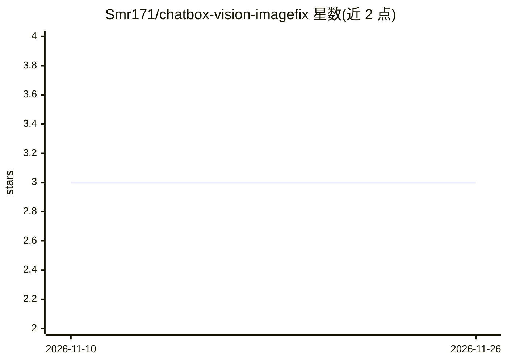

# Smr171/chatbox-vision-imagefix

⭐ 3 · GPL-3.0 · 推送 2026-11-09 · [GitHub](https://github.com/Smr171/chatbox-vision-imagefix) · 个人维护 · 中文 README

**修复知识库图片识别链路的 Chatbox Windows 修改版**

基于 Chatbox v1.23.5 的 Windows x64 非官方修改版，修复知识库内容送入模型时丢失图片的问题：本地 PDF 从文字提取改为按页渲染并保留页码关联，检索到的图片支持按需视觉分析（inspect_knowledge_base_images），图表细线提供局部裁剪修正，切换视觉模型后失效缓存，并区分超时、接口拒绝与供应商服务错误。提供独立安装身份可与官方 Chatbox 并用；安装包经 SHA-256 校验，源码与补丁随 Release 提供，遵循 GPL v3.0。不含自动更新与背景壁纸类改动。

## 筛选速览

| 维度 | 判定 | 备注 |
|---|---|---|
| AI 角色 | `ai-native` | 本体是模型或模型工具 |
| 许可风险 | `viral` | GPL-3.0 |
| 部署形态 | `desktop` | 安装包/桌面程序 |
| 模型依赖 | — | README 未给出锁定关系 |
| 硬件要求 | — | 无带数字的原话,不猜 |
| 安装摩擦 | `low` | 无编译、无系统依赖或容器化 |
| 成熟度 | — | 结构信号不足 |

## 能力要点

- 本地 PDF 按页渲染，识图时回到原页并保留文字检索关联
- 知识库原图读取与按需视觉分析（inspect_knowledge_base_images）
- 切换视觉模型后立即失效缓存，避免请求沿用旧模型
- 读图请求超时控制：单图 150 秒、整体 210 秒，并记录阶段耗时

## 适用场景

- 在知识库问答中让模型读取 PDF 里的图表和插图而非仅文字
- 排查知识库读图失败与模型读错图的场景
- 与官方 Chatbox 并行安装使用

## 场景标签

`文档问答` `RAG` `多模态` · 领域:知识与检索

## 证据(README 行号)

> L9: 这个版本不是换一个更强的模型，而是修复 Chatbox 把知识库内容交给模型时丢失图片的问题：
> L33: - 知识库原图读取和按需视觉分析（`inspect_knowledge_base_images`）
> L60: - 一个支持图片输入的视觉模型及其 API 凭据

## 星数曲线

2026-11-10 3 → 2026-11-26 3（+0）

---
*卡片 v1 · prompt 1.4 · 生成 2026-11-22 · 置信度 high · 依据 README sha `cafbca0d083f` · [字段定义](../../DATASET.md)*
