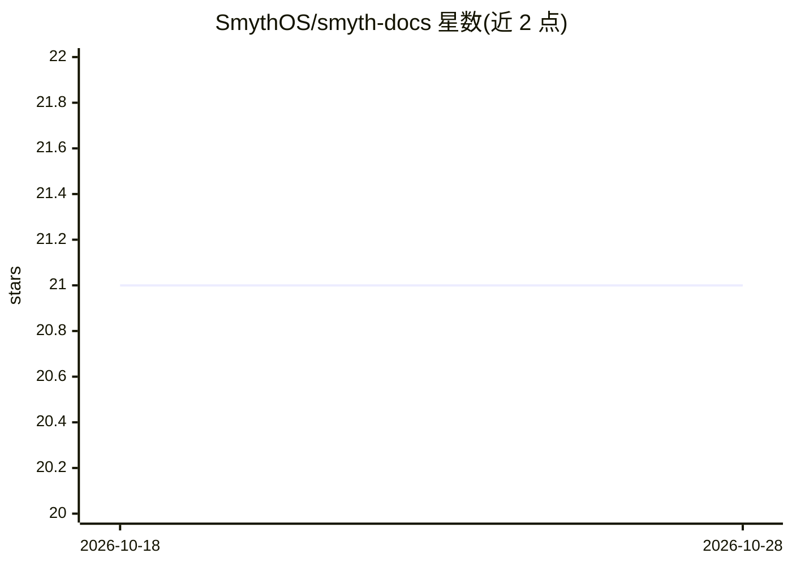

# SmythOS/smyth-docs

⭐ 21 · TypeScript · NOASSERTION · 推送 2026-04-03 · [GitHub](https://github.com/SmythOS/smyth-docs) · [官网](https://smythos.com/docs/) · 组织维护

**SmythOS 官方开源文档仓库：代理构建/部署/协作文档**

SmythOS 的开源文档仓库，内容以 Markdown/MDX 编写并用 Docusaurus 构建。文档覆盖该平台的多个组成部分：云端可视化构建代理的 Studio、以自然语言目标生成代理的 Weaver、本地或规模化运行代理的 Runtime、版本化部署、基于 Spaces/Groups 的团队协作、预置代理模板以及账户管理。本仓库仅包含文档本身，不含产品代码；需 Node.js 18+ 环境，通过 npm install 安装依赖后本地运行。README 末尾提及将发布开源可视化代理 IDE。

## 筛选速览

| 维度 | 判定 | 备注 |
|---|---|---|
| AI 角色 | `ai-knowledge` | 知识聚合/清单类 |
| 许可风险 | `none` | NOASSERTION |
| 部署形态 | `library` | 以包/库形式分发 |
| 模型依赖 | — | README 未给出锁定关系 |
| 硬件要求 | — | 无带数字的原话,不猜 |
| 安装摩擦 | `low` | 无编译、无系统依赖或容器化 |
| 成熟度 | — | 结构信号不足 |

## 能力要点

- 文档以 Markdown/MDX 编写，Docusaurus 构建
- 覆盖 Studio/Weaver/Runtime/部署/协作/模板六大板块
- 可本地运行开发服务器或生成静态构建

## 适用场景

- 查阅 SmythOS 代理构建、运行与部署的官方文档
- 本地搭建文档站点以浏览或贡献内容
- 通过 PR 参与文档修订

## 场景标签

`Agent 框架` · 领域:Agent 开发

## 证据(README 行号)

> L3: This repository contains the **open source** documentation for SmythOS. The docs are written in Markdown/MDX and bui
> L5: The content covers everything from building agents in the cloud-based Studio to running them locally with the Runtim

## 星数曲线

2026-10-18 21 → 2026-10-28 21（+0）

---
*卡片 v1 · prompt 1.4 · 生成 2026-10-28 · 置信度 high · 依据 README sha `679dee8206b8` · [字段定义](../../DATASET.md)*
