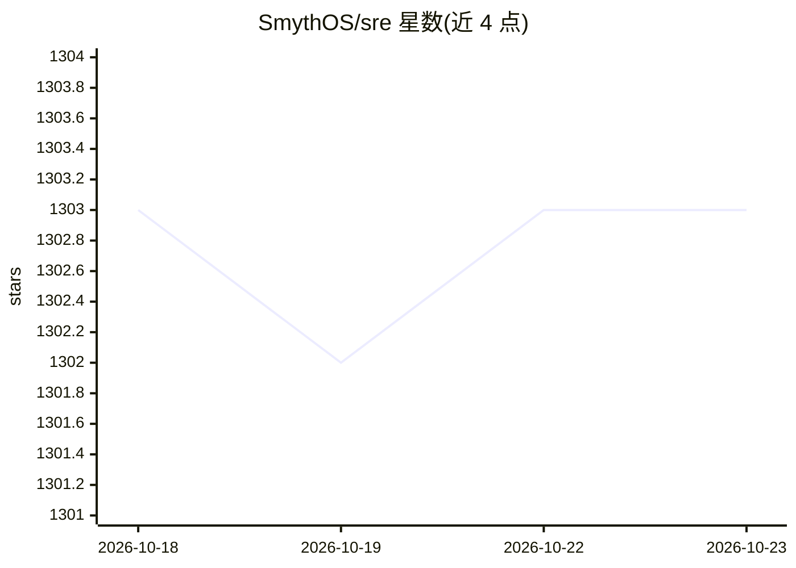

# SmythOS/sre

⭐ 1,303 · TypeScript · MIT · 推送 2026-04-03 · [GitHub](https://github.com/SmythOS/sre) · [官网](https://smythos.com) · 组织维护

**面向生产环境 AI agent 的开源运行时与 SDK**

SmythOS Runtime Environment（SRE）是运行 AI agent 的核心运行时，配套 TypeScript SDK 与 CLI，以操作系统内核式的架构对 LLM、向量数据库、存储、缓存等 AI 资源做统一抽象，同一接口覆盖 OpenAI、Anthropic、AWS Bedrock 等多种 provider。内置 Candidate/ACL 权限体系、40 余个生产组件，支持加载 .smyth 文件或用代码构建 agent，可运行于本地、云与边缘环境。通过 npm 安装，MIT 许可。

## 筛选速览

| 维度 | 判定 | 备注 |
|---|---|---|
| AI 角色 | `ai-ecosystem` | LLM/agent 周边工具 |
| 许可风险 | `permissive` | MIT |
| 部署形态 | `library` | 以包/库形式分发 |
| 模型依赖 | locked-api |  |
| 硬件要求 | — | 无带数字的原话,不猜 |
| 安装摩擦 | `low` | 无编译、无系统依赖或容器化 |
| 成熟度 | — | 结构信号不足 |

## 能力要点

- 对 LLM/VectorDB/Storage/Cache/Vault 的统一资源抽象与可插拔连接器
- 内置 Candidate/ACL 访问控制与凭据管理（Vault 支持 JSON 文件、AWS Secrets Manager、HashiCorp）
- 40+ 生产组件，覆盖 AI/LLM、外部调用、数据、逻辑、存储与代码执行
- 支持流式与带记忆的对话模式，可加载 .smyth 文件运行 agent

## 适用场景

- 用统一 SDK 构建并部署跨云/本地运行的 AI agent
- 在多个 LLM 与存储 provider 之间切换而不改业务逻辑
- 为 agent 平台引入企业级访问控制与凭据隔离

## 场景标签

`Agent 框架` · 领域:Agent 开发

## 证据(README 行号)

> L12: SRE is an open-source runtime and SDK for production AI agents. It provides OS-level abstractions for AI resources—
> L90: - **Agent Orchestration**: Complete agent lifecycle management

## 星数曲线

2026-10-18 1,303 → 2026-10-23 1,303（+0）

---
*卡片 v1 · prompt 1.4 · 生成 2026-10-21 · 置信度 high · 依据 README sha `a80631f5a7f8` · [字段定义](../../DATASET.md)*
