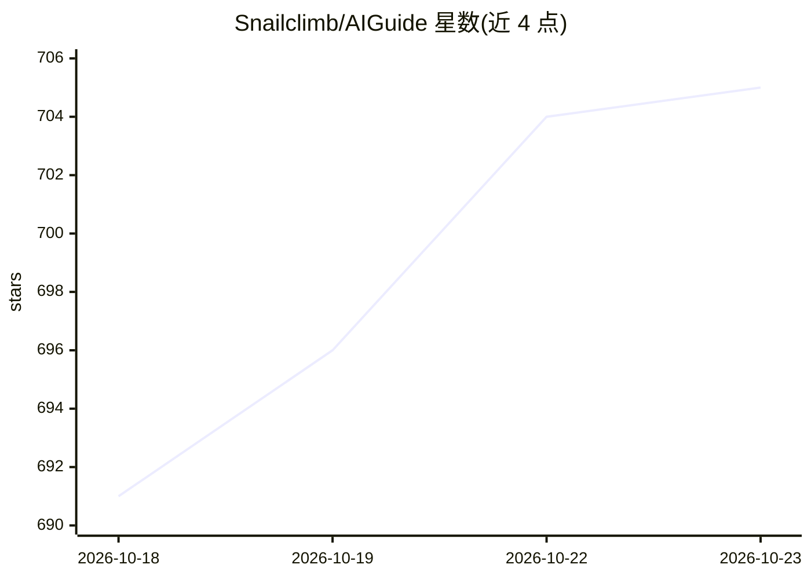

# Snailclimb/AIGuide

⭐ 705 · 推送 2026-07-07 · [GitHub](https://github.com/Snailclimb/AIGuide) · [官网](https://javaguide.cn/ai/) · 个人维护 · 中文 README

**面向工程师的 AI 应用开发与 AI 编程中文学习指南**

JavaGuide 作者维护的开源中文知识库，系统整理 AI 应用开发、AI 编程实战与面试内容：按大模型基础、AI Agent、RAG、AI 系统设计、AI 编程实战与技巧等专题组织文章，面向后端、前端、测试、架构师与产品技术同学，无需算法背景即可阅读；同时附带少量可直接安装的 Agent Skill（drawio-chart、java-coding-standards），通过 npx skills 或 Codex 脚本安装。提供在线阅读站点，内容持续更新中。

## 筛选速览

| 维度 | 判定 | 备注 |
|---|---|---|
| AI 角色 | `ai-knowledge` | 知识聚合/清单类 |
| 许可风险 | `none` | — |
| 部署形态 | `library` | 以包/库形式分发 |
| 模型依赖 | — | README 未给出锁定关系 |
| 硬件要求 | — | 无带数字的原话,不猜 |
| 安装摩擦 | `low` | 无编译、无系统依赖或容器化 |
| 成熟度 | — | 结构信号不足 |

## 能力要点

- 按大模型基础/Agent/RAG/系统设计/AI 编程等专题组织的系列文章
- 附学习路线、面试题专题与工程实践场景
- 提供可安装的 Agent Skill（drawio-chart、java-coding-standards），支持 npx 与 Codex 脚本安装
- 提供在线阅读站点

## 适用场景

- 系统学习 LLM、Agent、RAG、MCP 等 AI 应用开发知识
- 准备 AI 应用开发方向的面试
- 查找 Claude Code、Codex 等 AI 编程工具的使用方法与工作流
- 为自己的 Agent 安装 draw.io 图表生成或 Java 编码规范技能

## 场景标签

`教程课程` · 领域:学习与行业

## 证据(README 行号)

> L5: 这份开源指南写给所有想系统学习 **AI 应用开发与 AI 工程化落地** 的同学：后端、前端、测试、架构师、技术管理者、产品技术同学都可以看。你不需要先转算法岗，也不需要一上来就啃训练框架和论文公式；这里重点放在 LLM、Agen
> L46: 1. 先看 **大模型基础**：把 Token、上下文窗口、采样参数、API 调用、结构化输出和评测搞清楚。
> L53: ## 学习路线与建议

## 星数曲线

2026-10-18 691 → 2026-10-23 705（+14）

---
*卡片 v1 · prompt 1.4 · 生成 2026-10-21 · 置信度 high · 依据 README sha `05483a5546f9` · [字段定义](../../DATASET.md)*
