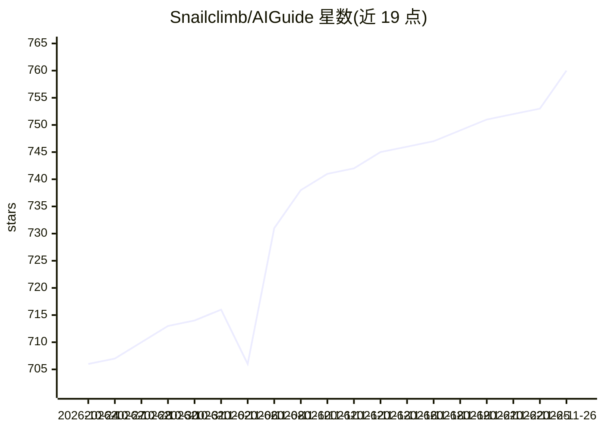

# Snailclimb/AIGuide

⭐ 760 · 推送 2026-11-06 · [GitHub](https://github.com/Snailclimb/AIGuide) · [官网](https://javaguide.cn/ai/) · 个人维护 · 中文 README

**面向开发者学习 AI 应用开发与 AI 编程的中文指南**

由 JavaGuide 作者维护的开源知识库，内容按大模型基础、AI Agent、RAG、AI 系统设计、AI 编程实战与面试题组织，覆盖 LLM API 调用、上下文工程、MCP、向量检索、模型网关、可观测性与安全等主题，并提供学习路线与面试复盘材料。仓库同时附带可安装的 Agent Skills（drawio-chart、java-coding-standards），通过 npx 或 Codex 安装脚本部署。在线阅读托管于 javaguide.cn，内容持续更新。

## 筛选速览

| 维度 | 判定 | 备注 |
|---|---|---|
| AI 角色 | `ai-knowledge` | 知识聚合/清单类 |
| 许可风险 | `none` | — |
| 部署形态 | `library` | 以包/库形式分发 |
| 模型依赖 | — | README 未给出锁定关系 |
| 硬件要求 | — | 无带数字的原话,不猜 |
| 安装摩擦 | `low` | 无编译、无系统依赖或容器化 |
| 成熟度 | — | 结构信号不足 |

## 能力要点

- 按大模型基础、Agent、RAG、系统设计组织的教程与面试题体系
- 附带可直接安装的 Agent Skills（drawio-chart、java-coding-standards）
- 提供面向后端/前端/测试等角色的学习路线合集
- Claude Code 原理进阶专题（上下文管理、Memory、Hooks、Multi-Agent）

## 适用场景

- 系统入门 AI 应用开发，补齐 RAG/Agent/评测知识
- 准备 AI 应用开发岗位的面试复盘
- 为 AI 编程工具（Claude Code/Codex/Cursor）配置工程 Skills

## 场景标签

`教程课程` · 领域:学习与行业

## 证据(README 行号)

> L5: 这份开源指南写给所有想系统学习 **AI 应用开发与 AI 工程化落地** 的同学：后端、前端、测试、架构师、技术管理者、产品技术同学都可以看。你不需要先转算法岗，也不需要一上来就啃训练框架和论文公式；这里重点放在 LLM、Agen
> L23: AIGuide 仓库里也会同步维护一部分可直接安装的 Agent Skill，目前已提供：
> L63: - AI 应用开发面试题专题：按大模型基础、AI Agent、RAG 和 AI 系统设计组织复习路线。

## 星数曲线

2026-10-24 706 → 2026-11-26 760（+54）

---
*卡片 v1 · prompt 1.4 · 生成 2026-11-24 · 置信度 high · 依据 README sha `5983803aec99` · [字段定义](../../DATASET.md)*
