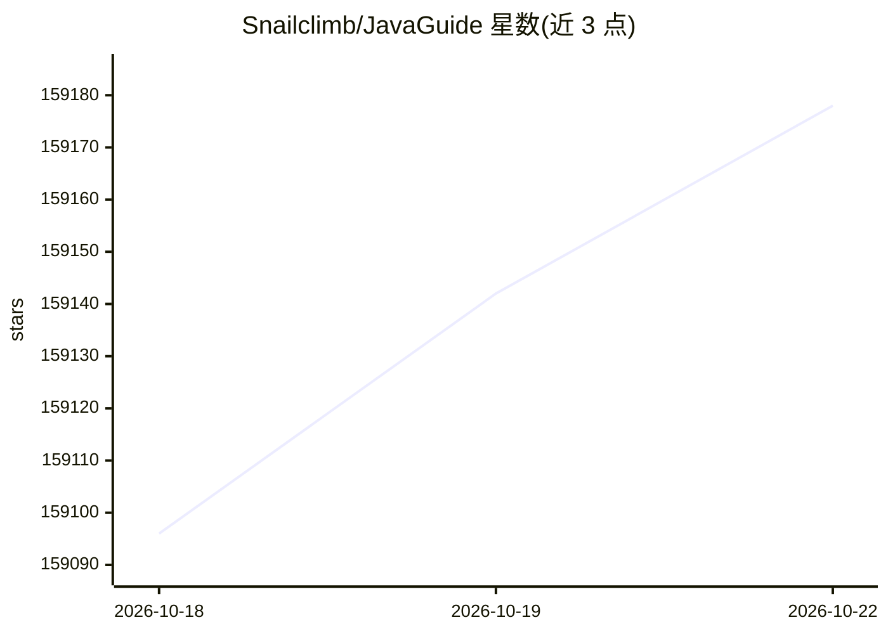

# Snailclimb/JavaGuide

⭐ 159,207 · JavaScript · Apache-2.0 · 推送 2026-10-16 · [GitHub](https://github.com/Snailclimb/JavaGuide) · [官网](https://javaguide.cn) · 个人维护 · 中文 README

**Java 后端求职者的面试知识指南，覆盖基础到分布式**

以 Markdown 文章目录为主体的知识库，按 Java 基础/集合/并发/JVM、计算机基础、MySQL/Redis/MongoDB、分布式、高性能、高可用、系统设计等板块组织面试知识点与学习路线，并提供在线阅读站与面试突击 PDF 版。README 同时列出新方向的 AI 应用开发面试指南（LLM、Agent、RAG、MCP），但该内容位于另一仓库 AIGuide；本仓库为纯文档项目，无安装或运行步骤。

## 筛选速览

| 维度 | 判定 | 备注 |
|---|---|---|
| AI 角色 | `ai-knowledge` | 知识聚合/清单类 |
| 许可风险 | `permissive` | Apache-2.0 |
| 部署形态 | `None` |  |
| 模型依赖 | — | README 未给出锁定关系 |
| 硬件要求 | — | 无带数字的原话,不猜 |
| 安装摩擦 | `medium` | 含编译或系统依赖之一 |
| 成熟度 | — | 结构信号不足 |

## 动量与使用信号

- 维护:`active` — 距上次 push 2.0 天,年发版 0,415 位贡献者
- 涨星:近 1 天 **+33**(自 20261016 起算)
- 平台:— · 协议:MCP

## 能力要点

- 按面试板块组织的知识点/面试题总结目录（Java、数据库、分布式、系统设计等）
- 提供在线阅读站与面试突击版 PDF 下载
- 含 Java 后端面试通关计划、学习路线与简历指南
- 另有独立的 AI 应用开发面试指南仓库（LLM/Agent/RAG/MCP）

## 适用场景

- 系统准备 Java 后端校招或社招面试
- 按学习路线补齐计算机基础与分布式知识
- 写简历和整理项目经验时参考指南

## 场景标签

`教程课程` · 领域:学习与行业

## 证据(README 行号)

> L12: > - **大模型实战项目**： ⭐AI 智能面试辅助平台 + RAG 知识库（基于 Spring Boot 4.0 + Java 21 + Spring AI 2.0，非常适合作为学习和简历项目，学习门槛低）。
> L22: 面向后端开发者的 AI 应用开发、AI 编程实战与面试指南已开源，涵盖 LLM、Agent、RAG、MCP、Claude Code、Codex 等核心技术与工程实践。对标 JavaGuide！有帮助的话，欢迎 Star！
> L38: ## Java

## 星数曲线

2026-10-18 159,096 → 2026-10-22 159,178（+82）

---
*卡片 v1 · prompt 1.4 · 生成 2026-10-18 · 置信度 high · 依据 README sha `089185373080` · [字段定义](../../DATASET.md)*
