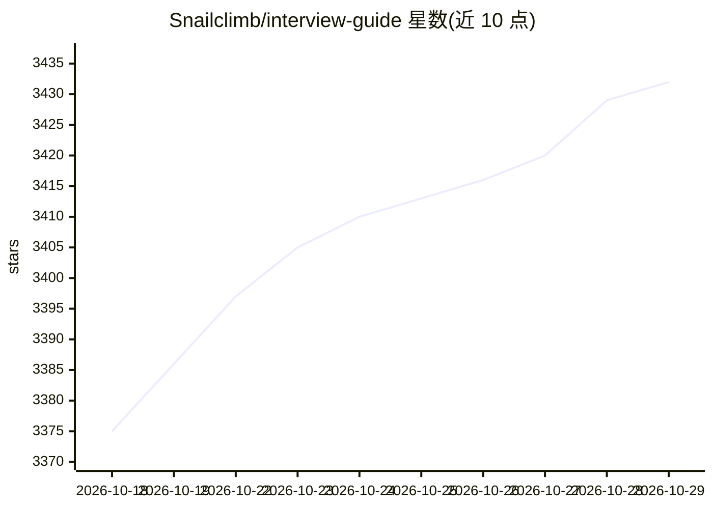

# Snailclimb/interview-guide

⭐ 3,432 · Java · AGPL-3.0 · 推送 2026-10-08 · [GitHub](https://github.com/Snailclimb/interview-guide) · [官网](https://javaguide.cn/zhuanlan/interview-guide.html) · 个人维护 · 中文 README

**面向求职者/HR/培训机构的开源 AI 面试平台**

InterviewGuide 是基于 Spring Boot 4.1、Spring AI 2.0、React 18 与 PostgreSQL/pgvector 的全栈 AI 面试辅助平台，提供简历多格式解析与 AI 分析报告、10+ 方向的 Skill 驱动模拟面试（文字+语音，语音基于千问3 ASR/TTS/LLM）、面试安排日历、知识库 RAG 问答与知识库题库生成面试等模块，并内置 DashScope/LM Studio/Kimi/DeepSeek/GLM 等 OpenAI 兼容多 Provider 管理。异步任务走 Redis Stream，文档向量化存 pgvector，对象存储用 S3 兼容的 RustFS/MinIO。支持 Docker 一键部署，README 声明完整功能免费开源。

## 筛选速览

| 维度 | 判定 | 备注 |
|---|---|---|
| AI 角色 | `ai-native` | 本体是模型或模型工具 |
| 许可风险 | `viral` | AGPL-3.0 |
| 部署形态 | `self-host` | docker 或自建部署 |
| 模型依赖 | — | README 未给出锁定关系 |
| 硬件要求 | — | 无带数字的原话,不猜 |
| 安装摩擦 | `low` | 无编译、无系统依赖或容器化 |
| 成熟度 | — | 结构信号不足 |

## 能力要点

- 简历多格式解析与异步 AI 分析，失败自动重试（最多3次）、PDF 报告导出
- Skill 驱动出题（10+ 面试方向），文字/语音面试共用统一评估引擎
- WebSocket + 千问3 语音模型的实时语音面试（流式 TTS、服务端 VAD、回声防护）
- 知识库 RAG 问答（pgvector + 查询改写 + TopK），并支持从知识库生成题库与专项面试

## 适用场景

- 求职者上传简历获取 AI 分析，并进行模拟面试练习
- HR 批量分析简历，评估候选人
- 培训机构管理知识库资源并提供面试培训服务
- 团队私有化部署一套带语音面试的知识库问答平台

## 场景标签

`语音 Agent` `文档问答` · 领域:对话与助手

## 证据(README 行号)

> L1: **智能 AI 面试官平台** - 基于大语言模型的简历分析、模拟面试和 RAG 知识库系统
> L11: InterviewGuide 是一个集成了简历分析、模拟面试（文字 + 语音）、面试安排、知识库管理、知识库题库面试和多模型配置的智能面试辅助平台。系统利用大语言模型（LLM）、向量数据库、Redis Stream 异步任务和实时
> L372: ## 使用场景

## 星数曲线

2026-10-18 3,375 → 2026-10-29 3,432（+57）

---
*卡片 v1 · prompt 1.4 · 生成 2026-10-20 · 置信度 mid · 依据 README sha `91f85199b3ad` · [字段定义](../../DATASET.md)*
