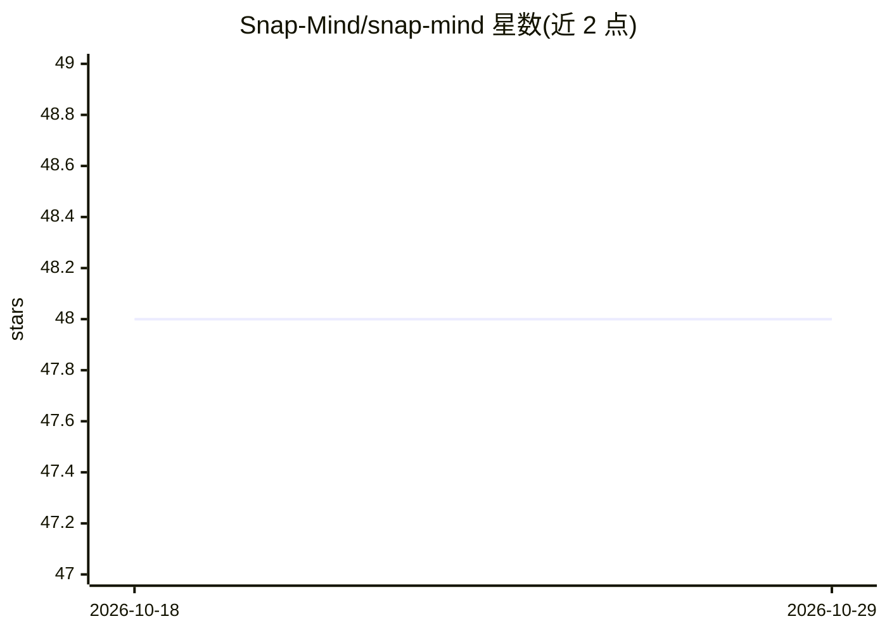

# Snap-Mind/snap-mind

⭐ 48 · TypeScript · Apache-2.0 · 推送 2026-10-20 · [GitHub](https://github.com/Snap-Mind/snap-mind) · [官网](https://snap-mind.github.io/) · 组织维护 · 中文 README

**桌面快捷键 AI 助手：划词即翻译、改写、总结**

基于 Electron 的跨平台桌面 AI 助手：在任意应用中选中文本并按热键，向 LLM 请求翻译、改写、摘要、解释、起草等操作，无需切换应用。支持 OpenAI、Anthropic、Azure (OpenAI/Foundry)、Google Gemini、DeepSeek、Qwen 六类提供商，可自定义常用任务提示词。macOS 与 Windows 提供安装包；Windows 需管理员权限运行，macOS 需授予辅助功能与钥匙串权限。开发者可经 git clone 与 npm 构建。

## 筛选速览

| 维度 | 判定 | 备注 |
|---|---|---|
| AI 角色 | `ai-native` | 本体是模型或模型工具 |
| 许可风险 | `permissive` | Apache-2.0 |
| 部署形态 | `library` | 以包/库形式分发 |
| 模型依赖 | locked-api |  |
| 硬件要求 | — | 无带数字的原话,不猜 |
| 安装摩擦 | `low` | 无编译、无系统依赖或容器化 |
| 成熟度 | — | 结构信号不足 |

## 能力要点

- 选中文本+热键在任意应用内触发 LLM
- 支持 OpenAI/Anthropic/Azure/Gemini/DeepSeek/Qwen 六类提供商
- 可自定义循环任务的提示词

## 适用场景

- 在任何应用里划词即时翻译或摘要
- 快速润色改写邮件与段落
- 选中代码或概念获取即时解释
- 把零散笔记转成结构化行动项

## 场景标签

`AI 助手` `AI 写作` · 领域:对话与助手

## 证据(README 行号)

> L19: SnapMind is a desktop AI assistant that lets you **instantly interact with LLMs** from anywhere in your system. Sel
> L30:  OpenAI
> L62: Download the latest installer from 👉 snap-mind.github.io or Releases.

## 星数曲线

2026-10-18 48 → 2026-10-29 48（+0）

---
*卡片 v1 · prompt 1.4 · 生成 2026-10-25 · 置信度 high · 依据 README sha `71afa231312a` · [字段定义](../../DATASET.md)*
