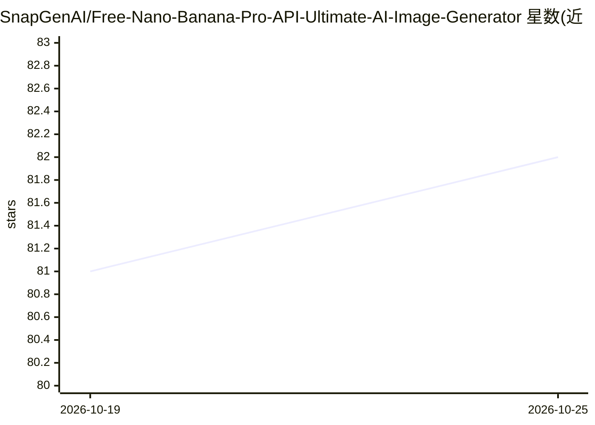

# SnapGenAI/Free-Nano-Banana-Pro-API-Ultimate-AI-Image-Generator

⭐ 82 · Apache-2.0 · 推送 2025-12-01 · [GitHub](https://github.com/SnapGenAI/Free-Nano-Banana-Pro-API-Ultimate-AI-Image-Generator) · [官网](https://geminigen.ai/) · 组织维护

**基于 Gemini 3.0 Pro 的免费图像生成 Web 应用与 API 服务**

提供 Web 应用与 API 两种形态的图像生成服务：底层调用 Google 的 Nano Banana Pro（Gemini 3.0 Pro）模型，支持文生图、风格转换（Anime/Ghibli/写实/电影感）、多比例（1:1/16:9 等）、参考图引导生成；面向创作者提供网页界面，面向开发者提供简单端点的 API。README 未给出本仓库代码的安装运行命令，主要导向外部网站 geminigen.ai 与 API 文档 docs.geminigen.ai，GitHub 仓库呈现为产品介绍页。

## 筛选速览

| 维度 | 判定 | 备注 |
|---|---|---|
| AI 角色 | `ai-native` | 本体是模型或模型工具 |
| 许可风险 | `permissive` | Apache-2.0 |
| 部署形态 | `None` |  |
| 模型依赖 | — | README 未给出锁定关系 |
| 硬件要求 | — | 无带数字的原话,不猜 |
| 安装摩擦 | `low` | 无编译、无系统依赖或容器化 |
| 成熟度 | — | 结构信号不足 |

## 能力要点

- 文生图与图像编辑，支持多种风格转换
- 参考图上传引导生成
- 开发者可通过简单端点的 API 接入
- 提供 1:1/16:9/3:4/9:16 等比例预设

## 适用场景

- 我想用文字提示词生成图像或转换已有照片风格
- 作为开发者想在应用中接入图像生成 API
- 制作社交媒体配图、横幅或缩略图

## 场景标签

`图像生成` · 领域:内容生成

## 证据(README 行号)

> L5: We offer A full-featured web app for seamless image editing, along with A dedicated platform that lets users with AP
> L23: - 📝 **Text-to-Image Generation** — Generate high-quality images from simple text prompts with support for multiple 

## 星数曲线

2026-10-19 81 → 2026-10-25 82（+1）

---
*卡片 v1 · prompt 1.4 · 生成 2026-10-24 · 置信度 high · 依据 README sha `b41fab95158f` · [字段定义](../../DATASET.md)*
