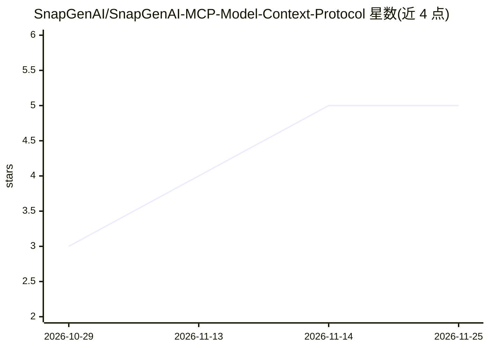

# SnapGenAI/SnapGenAI-MCP-Model-Context-Protocol

⭐ 5 · Python · Apache-2.0 · 推送 2026-11-17 · [GitHub](https://github.com/SnapGenAI/SnapGenAI-MCP-Model-Context-Protocol) · 组织维护

**给 AI 编程助手接入 SnapGen 生成模型的 MCP 服务器**

SnapGen 官方的 MCP 服务器：通过 stdio（本地）或 Streamable HTTP（托管）两种传输方式，把 SnapGen API 的 35 个图像/视频生成模型暴露为 MCP 工具，供 Claude Code、Codex、Cursor 等 MCP 客户端在对话中直接调用。提供 list_models/describe_model 自描述目录、请求前置校验避免无效扣费、异步任务轮询与 7 天签名链接返回。Python 3.10+ 源码安装，也可用 Docker 以非 root、无状态方式托管，API key 由用户自备且不落日志。

## 筛选速览

| 维度 | 判定 | 备注 |
|---|---|---|
| AI 角色 | `ai-ecosystem` | LLM/agent 周边工具 |
| 许可风险 | `permissive` | Apache-2.0 |
| 部署形态 | `desktop` | 安装包/桌面程序 |
| 模型依赖 | — | README 未给出锁定关系 |
| 硬件要求 | — | 无带数字的原话,不猜 |
| 安装摩擦 | `low` | 无编译、无系统依赖或容器化 |
| 成熟度 | — | 结构信号不足 |

## 能力要点

- 35 个模型（28 视频 + 7 图像）统一暴露为 MCP 工具
- describe_model/list_models 自描述模型选项与实时价格
- 请求先按模型规则校验，无效参数在扣费前拒绝
- 无状态 HTTP 服务 + Docker 镜像，带健康检查

## 适用场景

- 在 Claude Code/Codex/Cursor 对话里直接文生图、文生视频
- 用参考图/视频/音频引导生成角色与风格一致的结果
- 把生成能力作为托管 MCP 服务部署给团队使用

## 场景标签

`图像生成` `视频生成` · 领域:内容生成

## 证据(README 行号)

> L10: **SnapGen MCP Server** by SnapGen. Let your AI coding assistant create images and videos with **35 models** — Veo, 
> L17: - **🔌 Works With Your Assistant** — Connects to Claude Code, Codex, Cursor and any MCP client, locally over stdio o

## 星数曲线

2026-10-29 3 → 2026-11-25 5（+2）

---
*卡片 v1 · prompt 1.4 · 生成 2026-11-21 · 置信度 mid · 依据 README sha `803748eee6fd` · [字段定义](../../DATASET.md)*
