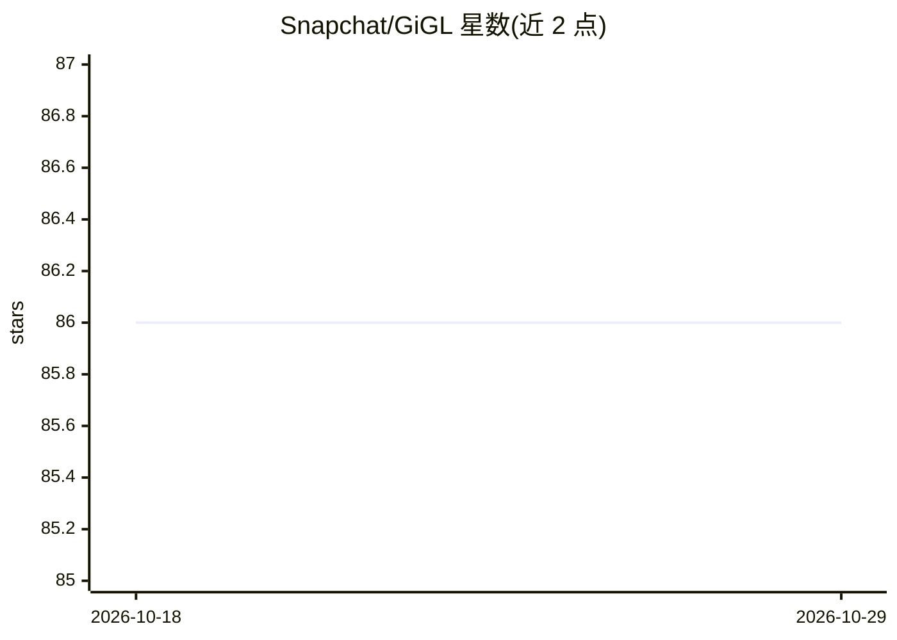

# Snapchat/GiGL

⭐ 86 · Python · NOASSERTION · 推送 2026-10-28 · [GitHub](https://github.com/Snapchat/GiGL) · [官网](https://snapchat.github.io/GiGL/) · 组织维护

**面向十亿级图的 GNN 训练与推理框架**

Snapchat 开源的图神经网络训练与推理库，面向十亿级规模图数据。架构以水平扩展为目标，覆盖数据预处理、模型训练与推理的端到端工作流，支持节点分类、链接预测等有监督/无监督任务。提供三种使用方式：Python import 调用组件、命令行模块执行、以及 local 与 Vertex AI（基于 Kubeflow Pipelines）的流水线编排。运行前需配置 Resource Config 与 Task Config 两个 YAML 文件。测试体系含 lint/单测/集成/云端端到端与性能测试。有 KDD 2025 论文，MIT 许可。

## 筛选速览

| 维度 | 判定 | 备注 |
|---|---|---|
| AI 角色 | `ai-ecosystem` | LLM/agent 周边工具 |
| 许可风险 | `none` | NOASSERTION |
| 部署形态 | `None` |  |
| 模型依赖 | — | README 未给出锁定关系 |
| 硬件要求 | — | 无带数字的原话,不猜 |
| 安装摩擦 | `low` | 无编译、无系统依赖或容器化 |
| 成熟度 | — | 结构信号不足 |

## 能力要点

- 支持十亿级规模图的 GNN 训练与推理
- 水平扩展架构覆盖预处理、训练、推理全流程
- 三种使用方式：import 调用、命令行、Vertex AI/Kubeflow 流水线编排
- 支持节点分类与链接预测等任务

## 适用场景

- 在大规模图数据上训练 GNN 做节点分类或链接预测
- 以流水线编排方式跑通端到端 GraphML 任务
- 将 GiGL 组件嵌入现有机器学习工作流

## 场景标签

`模型训练` `推理引擎` · 领域:训练与推理

## 证据(README 行号)

> L3: GiGL is an open-source library for training and inference of Graph Neural Networks at very large (billion) scale.
> L52: To easily get started or incorporate GiGL into your existing workflows, you can simply `import gigl` and call the

## 星数曲线

2026-10-18 86 → 2026-10-29 86（+0）

---
*卡片 v1 · prompt 1.4 · 生成 2026-10-24 · 置信度 high · 依据 README sha `857d358f39e1` · [字段定义](../../DATASET.md)*
