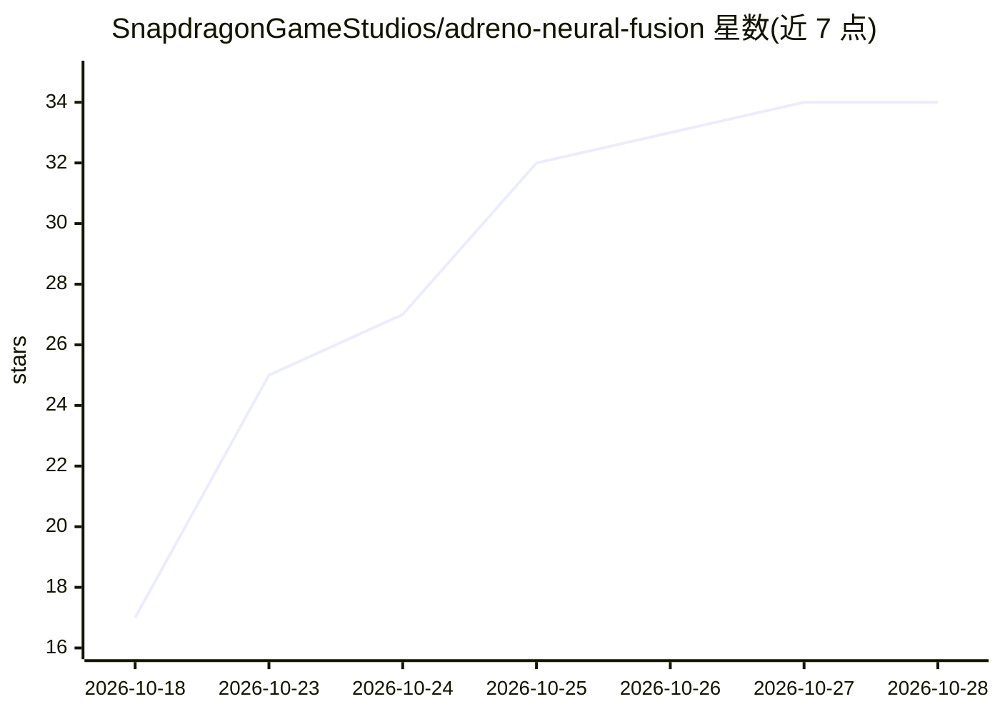

# SnapdragonGameStudios/adreno-neural-fusion

⭐ 35 · C · NOASSERTION · 推送 2026-10-20 · [GitHub](https://github.com/SnapdragonGameStudios/adreno-neural-fusion) · [官网](https://www.qualcomm.com/developer/snapdragon-game-toolkit) · 组织维护

**高通面向移动游戏的神经渲染 SDK：超分与帧生成**

高通发布的移动游戏神经渲染 SDK，提供两项技术：Super Resolution（SR，按应用选定输出尺寸重建画面）与 Frame Generation（FG，用连续帧、深度与运动矢量生成中间帧）。应用自行决定图像尺寸、渲染顺序与降级路径；SDK 在运行时报告硬件支持与 Vulkan 要求。以 arm64-v8a 的 Android 原生库（libanf.so）加 C 头文件形式提供，另含 Vulkan 示例、Unreal 与 Unity 插件及 SR 调试 overlay。限制：需 Snapdragon 8 Elite Gen 6 及以上、Vulkan 渲染器与降级路径。

## 筛选速览

| 维度 | 判定 | 备注 |
|---|---|---|
| AI 角色 | `ai-native` | 本体是模型或模型工具 |
| 许可风险 | `permissive` | NOASSERTION |
| 部署形态 | `None` |  |
| 模型依赖 | — | README 未给出锁定关系 |
| 硬件要求 | — | 无带数字的原话,不猜 |
| 安装摩擦 | `low` | 无编译、无系统依赖或容器化 |
| 成熟度 | — | 结构信号不足 |

## 能力要点

- SR 超分：输入抖动颜色/深度/运动矢量重建画面
- FG 帧生成：由连续帧与运动矢量生成中间帧
- 运行时报告硬件支持与 Vulkan 要求，应用配置降级路径
- 提供 Vulkan 原生 SDK、Unreal/Unity 插件与 SR 调试 overlay

## 适用场景

- 移动游戏在功耗受限下提升画质与显示帧率
- 在 Vulkan 渲染器中集成神经超分或帧生成
- 用调试 overlay 验证 SR 输入与时序行为

## 场景标签

`图像视频处理` · 领域:感知与多模态

## 证据(README 行号)

> L8: Adreno™ Neural Fusion is Qualcomm's neural rendering SDK for mobile games. It gives game teams more room to improve 
> L27: ### Super Resolution
> L33: ### Frame Generation

## 星数曲线

2026-10-18 17 → 2026-10-28 34（+17）

---
*卡片 v1 · prompt 1.4 · 生成 2026-10-25 · 置信度 high · 依据 README sha `3d01c65faec7` · [字段定义](../../DATASET.md)*
