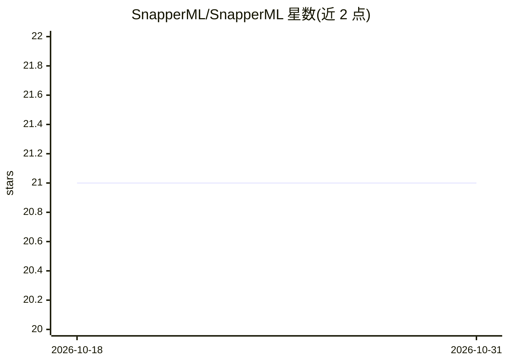

# SnapperML/SnapperML

⭐ 21 · Python · MIT · 推送 2026-04-22 · [GitHub](https://github.com/SnapperML/SnapperML) · [官网](https://snapperml.readthedocs.io/en/latest/) · 组织维护

**Python 实验追踪与 MLOps 框架：容器化运行与复现 ML 实验**

基于 MLflow、Ray、Docker 等技术构建的机器学习实验追踪与运营化（MLOps）框架，提供有固定工作流的本地与云端实验支持。功能包括通过 MLflow 自动记录参数与指标、基于 Optuna 与 Ray 的分布式训练和超参数优化、CLI 在容器内打包执行项目，以及 Vite/React/TypeScript 构建的 Web 界面用于管理实验配置与实时日志。需 Docker 与 Python 3.12+，实验结果存储于容器化的 MLflow 与 Optuna 数据库。附带 SoftwareX 2024 论文。

## 筛选速览

| 维度 | 判定 | 备注 |
|---|---|---|
| AI 角色 | `ai-ecosystem` | LLM/agent 周边工具 |
| 许可风险 | `permissive` | MIT |
| 部署形态 | `library` | 以包/库形式分发 |
| 模型依赖 | — | README 未给出锁定关系 |
| 硬件要求 | — | 无带数字的原话,不猜 |
| 安装摩擦 | `low` | 无编译、无系统依赖或容器化 |
| 成熟度 | — | 结构信号不足 |

## 能力要点

- MLflow 集成自动追踪参数与指标
- Optuna 与 Ray 支持分布式训练与超参数优化
- CLI 在容器内打包并执行实验项目
- Vite/React Web 界面管理实验配置与实时日志

## 适用场景

- 以 YAML 配置定义并通过 CLI 运行 ML 实验
- 在本地或云端做分布式训练与超参搜索
- 通过 Web 界面管理实验配置并追踪日志

## 场景标签

`MLOps` · 领域:训练与推理

## 证据(README 行号)

> L8: SnapperML is a comprehensive framework for experiment tracking and machine learning operationalization (MLOps), buil
> L31: - **Automatic Tracking**: Seamless integration with MLflow for parameter and metric tracking.
> L32: - **Distributed Training**: First-class support for distributed training and hyperparameter optimization using Optu

## 星数曲线

2026-10-18 21 → 2026-10-31 21（+0）

---
*卡片 v1 · prompt 1.4 · 生成 2026-10-28 · 置信度 high · 依据 README sha `00bba9fa9512` · [字段定义](../../DATASET.md)*
