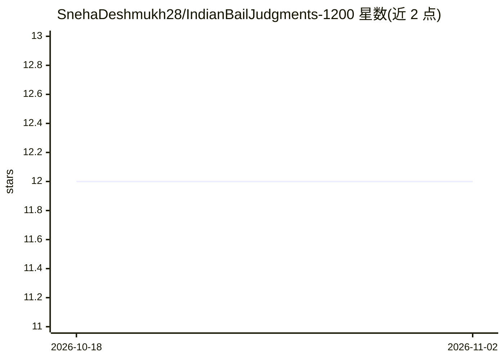

# SnehaDeshmukh28/IndianBailJudgments-1200

⭐ 12 · NOASSERTION · 推送 2025-12-05 · [GitHub](https://github.com/SnehaDeshmukh28/IndianBailJudgments-1200) · [官网](https://huggingface.co/datasets/SnehaDeshmukh/IndianBailJudgments-1200) · 个人维护

**印度保释判决标注数据集：1200 份法院命令（1975–2025）**

面向法律 NLP、公平性分析与司法研究的结构化数据集：收录 1975–2025 年间 1200 份经标注的印度保释相关法院命令，覆盖 78 个法院与 28 个地区，标注字段包括犯罪类型、援引的 IPC 条款、法官姓名、法律争议、保释结果与偏见标记等。提供 JSON/CSV/XLSX 三种格式及 1200 份对应 PDF 原文；本仓库为 Hugging Face 托管数据集的镜像。数据按 CC BY 4.0 许可发布。

## 筛选速览

| 维度 | 判定 | 备注 |
|---|---|---|
| AI 角色 | `ai-knowledge` | 知识聚合/清单类 |
| 许可风险 | `none` | NOASSERTION |
| 部署形态 | `None` |  |
| 模型依赖 | — | README 未给出锁定关系 |
| 硬件要求 | — | 无带数字的原话,不猜 |
| 安装摩擦 | `low` | 无编译、无系统依赖或容器化 |
| 成熟度 | — | 结构信号不足 |

## 能力要点

- 1200 份标注法院命令，时间跨度 1975–2025，覆盖 78 个法院与 28 个地区
- 每条含 IPC 条款、保释结果、偏见标记等 20 余个字段
- 提供 JSON/CSV/XLSX 格式及全部对应 PDF 原文
- 保释结果分布：736 例批准、464 例驳回，含 147 例里程碑案件

## 适用场景

- 法律文本分类、摘要与问答等 NLP 任务训练
- 司法透明度与保释决策偏见研究
- 法学院课程与标注训练材料

## 场景标签

 · 领域:法律 AI/数据集

## 证据(README 行号)

> L3: **IndianBailJudgments-1200** is a high-quality, structured dataset comprising **1,200** annotated Indian bail-relate
> L5: Designed for use in **legal NLP**, **fairness analysis**, and **judicial research**, this dataset enables exploratio

## 星数曲线

2026-10-18 12 → 2026-11-02 12（+0）

---
*卡片 v1 · prompt 1.4 · 生成 2026-11-01 · 置信度 high · 依据 README sha `99bdcf9daea5` · [字段定义](../../DATASET.md)*
