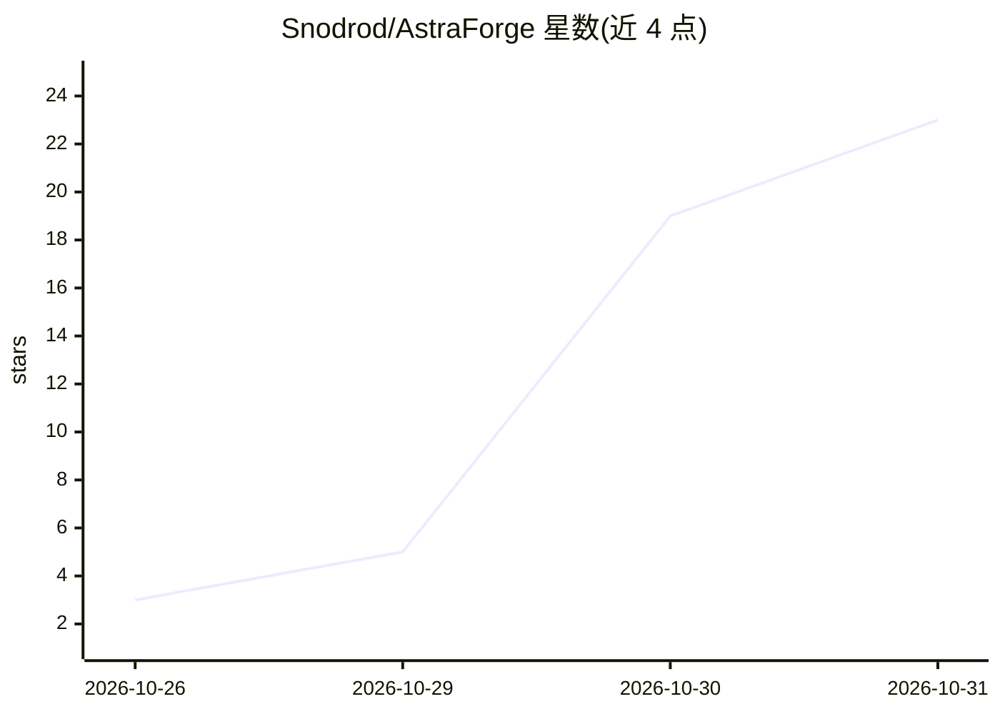

# Snodrod/AstraForge

⭐ 23 · Python · MIT · 推送 2026-10-30 · [GitHub](https://github.com/Snodrod/AstraForge) · [官网](https://snodrod.github.io/AstraForge/) · 个人维护 · 中文 README

**本地 3D 游戏资产制作工具：图片或文本生成 3D 模型并绑定导出**

Windows 本地应用，把单张图片或文本提示转换为游戏可用的 3D 资产：SDXL 文生图、rembg 去背景、Hunyuan3D 生成几何，之后在自带编辑器中做 UV/PBR 纹理、骨骼绑定、动画与特效，导出 GLB/OBJ/等距精灵图/Godot 包。默认全程离线，服务仅监听 127.0.0.1；AI 助手可选本地 Ollama 或 OpenAI/Anthropic。要求 NVIDIA GPU（最低 8GB VRAM），安装向导按需下载各组件（Quick 约 30GB）。源码为 MIT 的 0.3.0 旧版，新版采用免费非商业+订阅双许可。限制：无雕刻、逐顶点编辑，神经自动绑架等仅 Tripo 云端。

## 筛选速览

| 维度 | 判定 | 备注 |
|---|---|---|
| AI 角色 | `ai-native` | 本体是模型或模型工具 |
| 许可风险 | `permissive` | MIT |
| 部署形态 | `desktop` | 安装包/桌面程序 |
| 模型依赖 | local-ok | 支持本地模型 |
| 硬件要求 | — | 无带数字的原话,不猜 |
| 安装摩擦 | `medium` | 含编译或系统依赖之一 |
| 成熟度 | — | 结构信号不足 |

## 能力要点

- 文本/图片 → 3D 几何 → 绑架动画 → Godot 包的完整本地流水线（Hunyuan3D/SDXL/ComfyUI）
- 支持 Claude Code 引导的自动化安装与组件按需下载
- AI 助手仅返回受限的已验证操作，不执行任意代码
- 可选 Tripo 云 API 补充自动绑架、神经纹理等云端能力

## 适用场景

- 独立游戏开发者本地生成角色、道具的 3D 模型与 Godot 资产包
- 从一张 T-pose 正视图生成多视角并构建 3D 模型
- 在离线环境下完成建模、纹理、绑架、动画与导出

## 场景标签

`图像生成` · 领域:内容生成

## 证据(README 行号)

> L11: AstraForge is a Windows app that turns a picture or a text prompt into a game-ready 3D asset on your own machine: c
> L94: - **Create.** Upload a PNG/JPG/WEBP with one object on a neutral background, or type a prompt (SDXL makes the pictu

## 星数曲线

2026-10-26 3 → 2026-10-31 23（+20）

---
*卡片 v1 · prompt 1.4 · 生成 2026-10-30 · 置信度 mid · 依据 README sha `b9700c69ab6d` · [字段定义](../../DATASET.md)*
