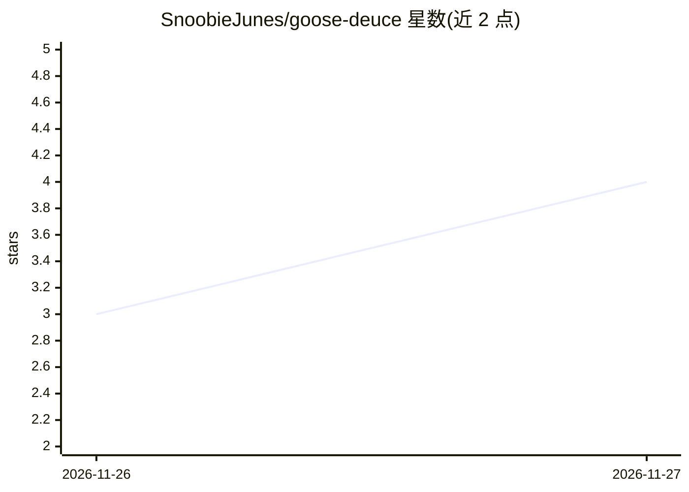

# SnoobieJunes/goose-deuce

⭐ 4 · MIT · 推送 2026-11-25 · [GitHub](https://github.com/SnoobieJunes/goose-deuce) · 个人维护

**约束 AI 编码代理工作流的纯 Markdown 操作手册套件**

一组可复制到项目仓库的 Markdown 模板（AGENTS.md、TASKS.md、goose-deuce.md 等），用序列化任务队列、可运行验收命令、不可变的偏离日志、同提交完成文档清扫、未经批准不推送等规则，针对 LLM 静默变通、任务蔓延、同义反复测试、上下文丢失等失败模式做结构性约束。无脚本与 CLI，依赖运行该手册的编码代理 harness（Goose、Claude Code、Codex 等）加载；大模板文件对小上下文模型需调大 context_file_max_chars 或裁剪。

## 筛选速览

| 维度 | 判定 | 备注 |
|---|---|---|
| AI 角色 | `ai-ecosystem` | LLM/agent 周边工具 |
| 许可风险 | `permissive` | MIT |
| 部署形态 | `None` |  |
| 模型依赖 | — | README 未给出锁定关系 |
| 硬件要求 | — | 无带数字的原话,不猜 |
| 安装摩擦 | `low` | 无编译、无系统依赖或容器化 |
| 成熟度 | — | 结构信号不足 |

## 能力要点

- TASKS.md 单一序列化任务队列 + 可运行的 Accept 验收命令
- goose-deuce.md 不可变偏离审计日志，每次会话开头读取
- 测试作为提交门槛：新行为附测试，修复附失败回归测试
- 多 harness 兼容表（Codex/Cursor/OpenCode/Claude Code/Goose/Hermes）

## 适用场景

- 让 AI 编码代理在新项目中按队列逐任务推进并过测试闸门
- 记录并审计代理每次偏离计划的改动
- 无人值守 /loop 会话加 autonomy 守护与停循环规则
- 在既有仓库中引入 AGENTS.md 规范代理行为

## 场景标签

`编码 Agent` · 领域:编码与开发

## 证据(README 行号)

> L3: **A plain-markdown operating system that keeps AI coding agents from improvising
> L107: |Harness|How it loads the law|Notes|
> L109: |**Codex / Cursor / OpenCode**|Reads `AGENTS.md` natively|—|

## 星数曲线

2026-11-26 3 → 2026-11-27 4（+1）

---
*卡片 v1 · prompt 1.4 · 生成 2026-11-26 · 置信度 high · 依据 README sha `106fc3c43dc6` · [字段定义](../../DATASET.md)*
