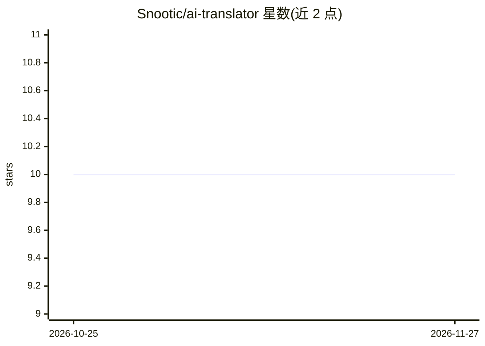

# Snootic/ai-translator

⭐ 10 · Python · GPL-3.0 · 推送 2026-07-26 · [GitHub](https://github.com/Snootic/ai-translator) · 个人维护

**用 AI 翻译 Office/PDF 文档且保留排版的桌面应用**

基于 Tauri 的桌面文档翻译应用，支持对 Word、Excel、PowerPoint、PDF 文件进行翻译，保持文件结构与格式不变，支持任意源/目标语言。翻译依赖 ChatGPT 或 DeepL 的 API key，即用户需自行配置这两类服务的密钥方可使用。README 附带多张界面截图，未给出安装或构建说明。

## 筛选速览

| 维度 | 判定 | 备注 |
|---|---|---|
| AI 角色 | `ai-native` | 本体是模型或模型工具 |
| 许可风险 | `viral` | GPL-3.0 |
| 部署形态 | `None` |  |
| 模型依赖 | — | README 未给出锁定关系 |
| 硬件要求 | — | 无带数字的原话,不猜 |
| 安装摩擦 | `low` | 无编译、无系统依赖或容器化 |
| 成熟度 | — | 结构信号不足 |

## 能力要点

- 支持 Word、Excel、PowerPoint、PDF 文档翻译
- 翻译时保持文件结构与格式不变
- 依赖 ChatGPT 和/或 DeepL API key 运行
- 支持任意源语言与目标语言

## 适用场景

- 翻译需要保留排版的 Office 办公文档
- 将 PDF 文件翻译成其他语言
- 配置自有 ChatGPT/DeepL 密钥批量翻译文件

## 场景标签

`AI 写作` · 领域:内容生成

## 证据(README 行号)

> L2: Translate mutiple type of files natively using AI mainting the file structure and formatting intact!
> L4: **This app relies on ChatGPT and/or DeepL API_Keys**

## 星数曲线

2026-10-25 10 → 2026-11-27 10（+0）

---
*卡片 v1 · prompt 1.4 · 生成 2026-11-20 · 置信度 high · 依据 README sha `641a0e7febcc` · [字段定义](../../DATASET.md)*
